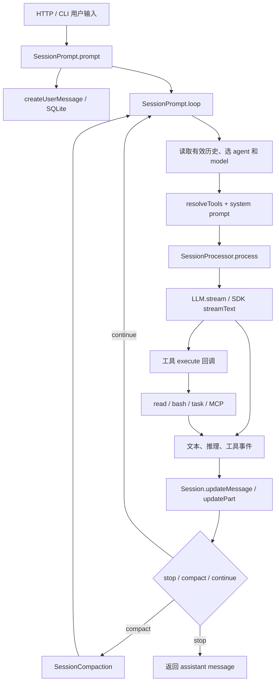

# 01 · v1.2.24 源码阅读地图

本篇只讲学习基线：`c6262f9d4002d86a1f1795c306aa329d45361d12`。本分支本地文件就是这个版本的源码；行号也按这个提交给出。新版变化从 [02](02-agent-loop.md) 开始。

## 一条主线就能串起核心结构

先从 `packages/opencode/src/session/prompt.ts` 读，不必先读完 CLI、UI、全部 provider 和配置系统。把它当成“收到用户输入后如何推进会话”的总调度器。



图中工具执行由 SDK 收到定义中的 `execute` 后触发；processor 对流事件做记录与状态管理。不要误以为 processor 的 `case 'tool-call'` 自己直接 `spawn` 了所有工具。

## 第一遍：只追一次普通文本输入

| 顺序 | 源码位置 | 重点看什么 | 暂时可以跳过什么 |
| --- | --- | --- | --- |
| 1 | [server/routes/session.ts:730](https://github.com/gaoch023/opencode/blob/c6262f9d4002d86a1f1795c306aa329d45361d12/packages/opencode/src/server/routes/session.ts#L730) | 普通 prompt HTTP 入口最终调用 `SessionPrompt.prompt`；异步入口与 SSE 不是 agent loop 本体 | OpenAPI schema 大段描述 |
| 2 | [session/prompt.ts:158](https://github.com/gaoch023/opencode/blob/c6262f9d4002d86a1f1795c306aa329d45361d12/packages/opencode/src/session/prompt.ts#L158) | 先创建 user message，再判断 `noReply`，最后进入 loop | 文件引用与图片展开细节 |
| 3 | [session/prompt.ts:274](https://github.com/gaoch023/opencode/blob/c6262f9d4002d86a1f1795c306aa329d45361d12/packages/opencode/src/session/prompt.ts#L274) | `start/resume`、同 Session 的 callbacks、清理和 `while (true)` | subtask/compaction 分支，先知道它们存在 |
| 4 | [session/prompt.ts:298](https://github.com/gaoch023/opencode/blob/c6262f9d4002d86a1f1795c306aa329d45361d12/packages/opencode/src/session/prompt.ts#L298) | 每轮重读历史，找 lastUser/lastAssistant/lastFinished，判断是否已经完成 | token 与费用字段 |
| 5 | [session/prompt.ts:658](https://github.com/gaoch023/opencode/blob/c6262f9d4002d86a1f1795c306aa329d45361d12/packages/opencode/src/session/prompt.ts#L658) | 把 agent、model、system、历史、tools 交给 processor | provider 特定参数 |
| 6 | [session/processor.ts:45](https://github.com/gaoch023/opencode/blob/c6262f9d4002d86a1f1795c306aa329d45361d12/packages/opencode/src/session/processor.ts#L45) | `LLM.stream`、消费 fullStream、把文本和工具事件写回历史 | 不常见的 reasoning/provider metadata 分支 |
| 7 | [session/llm.ts:46](https://github.com/gaoch023/opencode/blob/c6262f9d4002d86a1f1795c306aa329d45361d12/packages/opencode/src/session/llm.ts#L46) 与 [:172](https://github.com/gaoch023/opencode/blob/c6262f9d4002d86a1f1795c306aa329d45361d12/packages/opencode/src/session/llm.ts#L172) | 模型/认证/参数解析和 `streamText` 的边界 | 各 provider 的兼容变换 |
| 8 | [session/processor.ts:420](https://github.com/gaoch023/opencode/blob/c6262f9d4002d86a1f1795c306aa329d45361d12/packages/opencode/src/session/processor.ts#L420) 与 [prompt.ts:704](https://github.com/gaoch023/opencode/blob/c6262f9d4002d86a1f1795c306aa329d45361d12/packages/opencode/src/session/prompt.ts#L704) | processor 返回 stop/compact/continue，外层 loop 决定下一步 | UI 渲染 |

完成后你应该能回答：**为什么一个用户输入能产生多条 assistant 消息和多次模型请求？** 因为用户输入对应的 loop 会按模型 finish reason、工具结果和压缩请求重复推进；HTTP 请求数、assistant message 数、provider turn 数不是同一计数。

## 第二遍：沿一个 read 工具调用走完

1. 看 [tool/tool.ts:16](https://github.com/gaoch023/opencode/blob/c6262f9d4002d86a1f1795c306aa329d45361d12/packages/opencode/src/tool/tool.ts#L16)：工具的执行上下文带 sessionID、messageID、abort、metadata、ask，而不是只接受模型传来的 JSON。
2. 看 [tool/tool.ts:48](https://github.com/gaoch023/opencode/blob/c6262f9d4002d86a1f1795c306aa329d45361d12/packages/opencode/src/tool/tool.ts#L48)：`Tool.define` 包装 schema 校验、实际 execute 与输出截断。
3. 看 [session/prompt.ts:736](https://github.com/gaoch023/opencode/blob/c6262f9d4002d86a1f1795c306aa329d45361d12/packages/opencode/src/session/prompt.ts#L736)：`resolveTools` 为当前 agent/model 构造工具集合和权限上下文。
4. 看 [session/prompt.ts:783](https://github.com/gaoch023/opencode/blob/c6262f9d4002d86a1f1795c306aa329d45361d12/packages/opencode/src/session/prompt.ts#L783)：registry 的工具被转换为 SDK `tool({ inputSchema, execute })`。执行前后还会调用插件 hooks。
5. 看 [session/processor.ts:111](https://github.com/gaoch023/opencode/blob/c6262f9d4002d86a1f1795c306aa329d45361d12/packages/opencode/src/session/processor.ts#L111)：模型开始输出参数时写 pending part；完整 tool-call 后写 running；随后结果或错误把该 part 结算。
6. 看 [session/message-v2.ts:266](https://github.com/gaoch023/opencode/blob/c6262f9d4002d86a1f1795c306aa329d45361d12/packages/opencode/src/session/message-v2.ts#L266)：pending/running/completed/error 是工具调用的数据状态，不是四个 OS 进程状态。
7. 看 [session/message-v2.ts:496](https://github.com/gaoch023/opencode/blob/c6262f9d4002d86a1f1795c306aa329d45361d12/packages/opencode/src/session/message-v2.ts#L496)：下一轮把持久历史转换成模型能读的消息；模型才能看到工具结果再决定后续操作。

这里的文件名 `message-v2.ts` 已经存在于 v1.2.24。它是旧执行链使用的消息结构版本；不是后来独立 core 的 `SessionV2` 引擎。06 会单独解释这些同名陷阱。

## 第三遍：理解 Agent 与 child Session

先看 [agent/agent.ts:24](https://github.com/gaoch023/opencode/blob/c6262f9d4002d86a1f1795c306aa329d45361d12/packages/opencode/src/agent/agent.ts#L24)。`Agent.Info` 包含 name/mode/model/prompt/permission/steps 等。`build`、`plan`、`general`、`explore` 是配置身份；调用 `Agent.get('explore')` 本身不会启动线程或模型。

然后看 [tool/task.ts:45](https://github.com/gaoch023/opencode/blob/c6262f9d4002d86a1f1795c306aa329d45361d12/packages/opencode/src/tool/task.ts#L45)：

```text
父 loop 的 task tool call
  → 校验能否使用指定 subagent
  → 查找 task_id，或 Session.create({ parentID: 父 Session })
  → 选择子 agent/model，配置其工具权限
  → 把父 abort 接到子会话 cancel
  → await SessionPrompt.prompt({ sessionID: 子 Session, ... })
  → 取最后文本，返回 task_id + task_result 给父 tool call
```

关键源码：[创建子会话 :66](https://github.com/gaoch023/opencode/blob/c6262f9d4002d86a1f1795c306aa329d45361d12/packages/opencode/src/tool/task.ts#L66)、[取消与子 prompt :119](https://github.com/gaoch023/opencode/blob/c6262f9d4002d86a1f1795c306aa329d45361d12/packages/opencode/src/tool/task.ts#L119)、[结果包装 :145](https://github.com/gaoch023/opencode/blob/c6262f9d4002d86a1f1795c306aa329d45361d12/packages/opencode/src/tool/task.ts#L145)。

child Session 在同一个执行宿主中拥有另一段历史和一次独立 loop。它可以调用 bash 继而创建 OS 子进程，但“子 agent 的会话”与“bash 的子进程”是两回事。多个 task 工具若被并发调度，各自可以推进不同 Session；父工具逻辑 `await` 子任务，不等于它阻塞整个 JS 事件循环。

## 第四遍：持久记录与活跃执行分别在哪里

| 层 | 基线位置 | 保存什么 |
| --- | --- | --- |
| 会话身份 | [session/session.sql.ts:11](https://github.com/gaoch023/opencode/blob/c6262f9d4002d86a1f1795c306aa329d45361d12/packages/opencode/src/session/session.sql.ts#L11) | project、parent、directory、title、permission 等 |
| 消息与内容块 | [session/session.sql.ts:42](https://github.com/gaoch023/opencode/blob/c6262f9d4002d86a1f1795c306aa329d45361d12/packages/opencode/src/session/session.sql.ts#L42) | message/part 的 JSON 内容与归属关系 |
| 数据写入与通知 | [session/index.ts:679](https://github.com/gaoch023/opencode/blob/c6262f9d4002d86a1f1795c306aa329d45361d12/packages/opencode/src/session/index.ts#L679) | upsert message，再通过 Bus 通知消费者 |
| 正在执行的状态 | [session/prompt.ts:65](https://github.com/gaoch023/opencode/blob/c6262f9d4002d86a1f1795c306aa329d45361d12/packages/opencode/src/session/prompt.ts#L65) | Instance 内的 Session → AbortController + 等待回调 |
| UI 状态 | `session/status.ts` | busy/idle/retry 等对外状态 |

Session 数据写在 SQLite，**活跃 loop 的 Promise、AbortController 和 callbacks 并没有因此变成可持久执行的任务**。重启后能读回历史，不等于会自动知道某个命令究竟执行到了哪一步。这个区别是理解 V2 重构最重要的前置知识之一。

## 第五遍：异常、取消与压缩

- [processor.ts:353](https://github.com/gaoch023/opencode/blob/c6262f9d4002d86a1f1795c306aa329d45361d12/packages/opencode/src/session/processor.ts#L353)：区分上下文溢出、可重试错误、终止错误；retry 会经过退避和 abort-aware 等待，不应只看 provider SDK 的重试参数。
- [processor.ts:401](https://github.com/gaoch023/opencode/blob/c6262f9d4002d86a1f1795c306aa329d45361d12/packages/opencode/src/session/processor.ts#L401)：退出时将没结算的工具 part 标成错误，避免 UI 永远显示 running。
- [prompt.ts:528](https://github.com/gaoch023/opencode/blob/c6262f9d4002d86a1f1795c306aa329d45361d12/packages/opencode/src/session/prompt.ts#L528)：处理待执行压缩；[:704](https://github.com/gaoch023/opencode/blob/c6262f9d4002d86a1f1795c306aa329d45361d12/packages/opencode/src/session/prompt.ts#L704) 根据 processor 结果触发后续压缩。
- [tool/bash.ts:172](https://github.com/gaoch023/opencode/blob/c6262f9d4002d86a1f1795c306aa329d45361d12/packages/opencode/src/tool/bash.ts#L172)：真正启动 shell；[:208](https://github.com/gaoch023/opencode/blob/c6262f9d4002d86a1f1795c306aa329d45361d12/packages/opencode/src/tool/bash.ts#L208) 把 abort、timeout 与杀进程树接在一起。
- [prompt.ts:264](https://github.com/gaoch023/opencode/blob/c6262f9d4002d86a1f1795c306aa329d45361d12/packages/opencode/src/session/prompt.ts#L264)：Session 取消通过 AbortController 发出协作信号。外部副作用已发生时，取消不会自动回滚文件或网络请求。

## 给自己留的五道检查题

1. `prompt(noReply: true)` 与 `prompt_async` 哪个是“不生成回复”，哪个是“HTTP 先返回”？
2. `task_id` 恢复的是子会话身份，还是一个 OS PID？
3. `metadata()` 更新 UI 中的输出，和工具 execute 最终返回的 result 有什么时序关系？
4. `finish === 'tool-calls'` 为什么通常需要外层 loop 再调用一次模型？
5. 工具已写文件后进程崩溃，message/part 历史能证明它未执行吗？为什么不能直接重跑？

能用源码回答这些问题后，再读新版 Session coordinator、Inbox、EventV2 和 BackgroundJob 会轻松很多。
