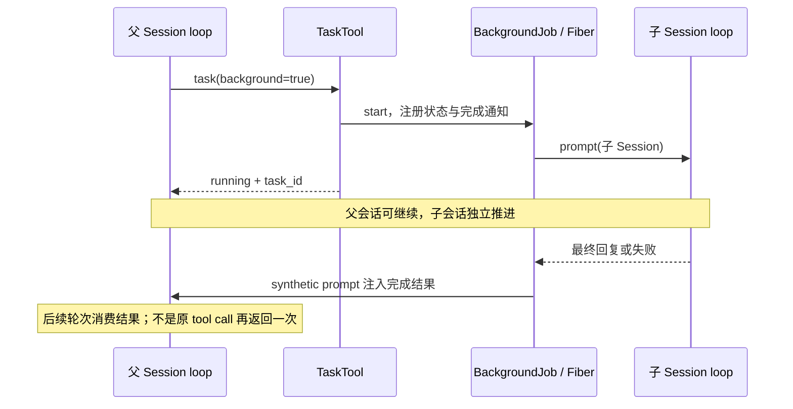

# 04 · 子 agent、工具注册与前后台调度

> **历史快照说明（2026-10-22 更新）：** 本文比较 v1.2.24 与 2026-10-08 的 `388406238b`，其中“当前/最新/V2”都指当时快照。远端已在 2026-10-10 推广 V2；当前 2.1.3 已支持 subagent 与 shell 后台执行、持久通知及受限启动恢复。当前能力请读 [07](07-current-v2.md) 和 [08](08-current-session.md)，不要将本文的未实现项当成当前结论。

> [返回学习总览](README.md)。A 为 v1.2.24，B 为固定 dev；有 C 标记时指同一 dev 中的 V2。行号按各自提交计算。

## 取证范围

- A（学习基线）：`c6262f9d4002d86a1f1795c306aa329d45361d12`，提交说明 `release: v1.2.24`。
- B（本次仓库最新 dev）：`388406238bd5ca15564a762840a2362c3a45bd9c`。同一提交中并存最新 V1 `packages/opencode` 与 V2 `packages/core`，下文“最新”只指这个固定提交，不声称外部 upstream 最新发布。
- A 行号通过 `git show A:path | nl -ba` 得到；B 行号来自分析时的固定 dev 快照；当前学习分支的应用源码为 A。以下为源码审查与测试文件证据，未在本次分析中实际运行这些测试。

## 先抓住三个不变概念

1. **Agent 是配置/策略，不是进程。** A 的 `Agent.Info` 包含 name、mode、permission、model、prompt、steps；`mode` 为 primary/subagent/all。B V1 仍保持这个模型，改用 Effect Schema 和服务。V2 为 Location-scoped AgentV2 状态服务，通过插件 transform 注册 build/plan/general/explore 等。
2. **Task 是一次委派给子 Session 的工作。** 子 Session 有独立历史，`parentID` 关联父 Session，`task_id` 可继续旧子 Session。Task 本身不 fork 操作系统进程，也不会自动创建 worktree；子 agent 使用相同项目环境，对同一文件的修改必须协调。
3. **前后台是调用者是否等待结果，与是否有 OS 子进程是两条轴。** Task 在同进程内跑 agent loop；bash/shell 另外 spawn shell 子进程。Effect Fiber 也不是 OS 进程。

证据：[A `packages/opencode/src/agent/agent.ts:23`](https://github.com/gaoch023/opencode/blob/c6262f9d4002d86a1f1795c306aa329d45361d12/packages/opencode/src/agent/agent.ts#L23)（Info）、`:51`（Instance.state）；[A `packages/opencode/src/tool/task.ts:66`](https://github.com/gaoch023/opencode/blob/c6262f9d4002d86a1f1795c306aa329d45361d12/packages/opencode/src/tool/task.ts#L66)（reuse/create Session）、`:128`（await prompt）；[B `packages/opencode/src/agent/agent.ts:35`](https://github.com/gaoch023/opencode/blob/388406238bd5ca15564a762840a2362c3a45bd9c/packages/opencode/src/agent/agent.ts#L35)（Info）、`:98`（InstanceState）；[B `packages/core/src/agent.ts:43`](https://github.com/gaoch023/opencode/blob/388406238bd5ca15564a762840a2362c3a45bd9c/packages/core/src/agent.ts#L43)（Service）、`:111`（makeLocationNode）。

## 总览表

| 维度 | v1.2.24（A） | 最新 V1（B / opencode） | V2（B / core） |
|---|---|---|---|
| 子 agent 定义 | Agent.Info 的 mode/permission/model/prompt | 同一概念，Effect 服务，增加配置、权限处理 | AgentV2/Location-scoped transform；agent 插件注册 general/explore |
| 模型调用 task | 已实现，默认同步等结果 | 已实现，前台默认，实验性后台 | **内置 task 仍未移植**，不能据 AgentV2 中存在 subagent 配置就推断可委派 |
| 子 Session | create(parentID) 或 task_id 续用 | 同上，新增 agent 字段及 parent session 权限传递 | V2 会话框架/agent 配置存在，但尚无内置 task 叶子来串起此流程 |
| 嵌套限制 | 没有独立深度计数；默认 child task deny，agent 自己有 task 权限时放开 | 显式计算祖先深度，默认 subagent_depth=1；允许配置更深，同时仍受 task 权限限制 | 不能把 V1 规则当作 V2 已实现行为 |
| 后台启动 | task 参数没有 background | background=true，需实验开关；立即返回 running，完成后 synthetic prompt 回注父 Session | bash 模型后台启动与观察 API 为 TODO；core BackgroundJob 引擎存在不代表已暴露给模型 |
| 前台转后台 | 无专门转换 | 可 promote 已运行的 task，不重启；前台 waiter 解除等待 | 未见内置 task 对应入口 |
| 后台状态 | 无通用 task job registry | BackgroundJob：内存注册、Fiber + Scope + Deferred | 共享 core 引擎定义 process-local；不是持久任务队列/worker 系统 |
| 工具执行 | AI SDK tool execute 返回 Promise | AI SDK execute ↔ EffectBridge ↔ Effect 工具；插件 before/after | 自己消费 tool-call，落库后 eager fork structured child fiber，等待所有已启动工具完成再继续下一轮 |
| 工具 schema | Zod input；Tool.define | Effect Schema input，插件 Zod 兼容边界保留 | input + output + structured schema；settle 校验入参与输出，返回 typed result |

## A：最适合先学明白的 task 完整链

```text
父 Session loop -> AI SDK tool.execute(task)
  -> task 权限检查 / Agent.get(subagent_type)
  -> task_id 存在则取子 Session，否则 Session.create(parentID=父ID)
  -> 从 agent.model 或父 assistant 消息选 model
  -> ctx.metadata 写子 Session ID，供界面关联
  -> 监听父工具 AbortSignal，转发 SessionPrompt.cancel(子ID)
  -> await SessionPrompt.prompt(子ID, agent, promptParts)
  -> 取子回复最后 text，返回 task_id + <task_result>
父工具获得最终结果，父 loop 才有这个结果可继续
```

逐点源码：[A `packages/opencode/src/tool/task.ts:14`](https://github.com/gaoch023/opencode/blob/c6262f9d4002d86a1f1795c306aa329d45361d12/packages/opencode/src/tool/task.ts#L14) 参数（无 background），`:27` 可用子 agent 目录与 task deny 过滤，`:48` 用户 @/命令显式委派 bypassAgentCheck，`:66` 续用/建 Session，`:75` child 默认权限，`:106` 模型选择，`:111` metadata，`:121` cancel 转发，`:128` await prompt，`:145` 取文本。

这也解释了“子 agent 有独立上下文”的准确含义：输入是 `resolvePromptParts(params.prompt)` 产生的 parts；创建的是新的 Session，没有在此复制父历史。父模型把要点放在 task.prompt 才是上下文交接。复用 task_id 则是在旧子 Session 上继续。

v1.2.24 已能并行工具，不能写成所有工具绝对串行：可选 `batch_tool` 路径中 `BatchTool` 最多保留前 25 调用，通过 `Promise.all` 并发等待，给每个嵌套工具写 running/completed/error part。[A `packages/opencode/src/tool/batch.ts:36`](https://github.com/gaoch023/opencode/blob/c6262f9d4002d86a1f1795c306aa329d45361d12/packages/opencode/src/tool/batch.ts#L36), `:63`, `:79`, `:132`；开关见 A `tool/registry.ts:121`。并行执行仍然不等于父模型在未收工具结果时进入下一轮。

## 最新 V1：在可理解的 task 上增加后台生命期

### 1. 新参数与深度

[B `packages/opencode/src/tool/task.ts:56`](https://github.com/gaoch023/opencode/blob/388406238bd5ca15564a762840a2362c3a45bd9c/packages/opencode/src/tool/task.ts#L56) 增加 `background`；`:98` 拒绝未启用 `OPENCODE_EXPERIMENTAL_BACKGROUND_SUBAGENTS=true` 的后台请求；`:362` 决定描述和对模型公布的 JSON schema（不开实验时公布 BaseParameters）。因此这是实验功能，不能表述为默认全部开启。

`:104` 沿 parentID 数祖先，`:111` 用 `cfg.subagent_depth ?? 1` 控制：默认 primary 能派一个子级，子级不能再派孙级。配置深度放开不自动绕过 task 权限。

### 2. 权限不再仅给子 Session 塞几个默认 deny

B `agent/subagent-permissions.ts:14` 的 `deriveSubagentSessionPermission` 保留父 **Session** 的 deny 和 external_directory 规则，再按子 agent 自身规则添加 task/todowrite 默认 deny。父 **Agent** 的所有限制不会整份继承：父 Agent 主要决定能否委派；子 Agent 策略决定子执行能力，父 Session 显式限制要传下去。TaskTool `:139` 调用 helper，`:143` 添加 primary_tools deny，`:158` 创建 child。真正工具权限合并在 `session/tools.ts:81`，组合当前 agent.permission + session.permission。

### 3. 前后台共用一份实际工作

B `task.ts:200` 的 runTask 仍调用 promptOps.prompt，检测子 assistant error 或终末 tool error，避免把失败当空字符串成功返回（`:213`）。`:284` 先 BackgroundJob.start，id=子 Session ID，`:296` 中断时调用 ops.cancel(child)。**即使默认前台，也先成为 job，然后等待。**

- 前台：`:321` 接父 AbortSignal，`:334` race(job.wait, waitForPromotion)。正常结束返回 completed；收到 promotion 返回 running，父 loop 得以继续。
- 后台：`:316` 注册通知，然后立即返回 running。
- 追加任务：`:267` background.extend 同一个已运行 job，返回 “Background task updated”。job pending 计数涵盖更新，等追加工作也结束后才整体完成。
- 完成通知：`:227` injectBackgroundResult 构造 synthetic text prompt，`:233` 再次 prompt 父 Session（agent 使用父当前 agent；保留 variant），`:253` forkIn 宿主 scope，不阻塞 job 完成等待。

`/experimental/session/:sessionID/background` 的 handler 在 [B `packages/opencode/src/server/routes/instance/httpapi/handlers/experimental.ts:159`](https://github.com/gaoch023/opencode/blob/388406238bd5ca15564a762840a2362c3a45bd9c/packages/opencode/src/server/routes/instance/httpapi/handlers/experimental.ts#L159)：选本父 Session 尚在 foreground 的 running task，调用 background.promote；API 不会重新启动子 agent。API 描述在 groups/experimental.ts:245。

### 4. 后台不是可跨进程恢复的 daemon

[B `packages/core/src/background-job.ts:113`](https://github.com/gaoch023/opencode/blob/388406238bd5ca15564a762840a2362c3a45bd9c/packages/core/src/background-job.ts#L113) 明确：registry **process-local、非 durable**，进程重启或 owner scope 关闭丢状态并中断 live work。`:173` fork 使用 Effect.forkIn，不是 spawn/fork OS 进程；`:35` state 为 SynchronizedRef<Map>；`:23`/`:24`/`:30` 以 Deferred 和 Scope 驱动等待、取消、promotion。

`packages/opencode/src/background/job.ts:17` 还给共享引擎加了 legacy InstanceState 包装，故最新 V1 使用的是 **instance-scoped registry**；core 节点本身是 global node。不要把引擎抽到 core 当作 V2 后台 task 完整实现。

### 5. 取消链完整性

[B `packages/opencode/src/session/run-state.ts:77`](https://github.com/gaoch023/opencode/blob/388406238bd5ca15564a762840a2362c3a45bd9c/packages/opencode/src/session/run-state.ts#L77) cancel 先 cancelBackgroundJobs 再 cancel 本 Session runner；`:111` 以 parentSessionId/sessionId 在 registry 遍历后代，多层递归取消。Task 前台 scope 被中断会同时 child cancel + background.cancel（task.ts:347）。删除 Session 时也取消对应作业，见 session/session.ts:616, :938。

后台的意义是脱离父工具的同步等待，不是永不被父取消影响。父 run cancel 会取消后代 background jobs；它也不是跨宿主进程/机器独立运行。

可读的测试证据（本次仅静态阅读）：`packages/opencode/test/tool/task.test.ts:248` 续用 ID，`:287` 子错误，`:507` 默认禁嵌套，`:549` 配置深度，`:588` 权限，`:655` 实验关闭拒绝后台，`:686` 前台 promotion 不重启，`:752` 后台立即返回，`:790` completion 等 updates，`:935` 删除父取消，`:974` 删除子取消，`:1013` cancel 父取消后台，`:1073` 递归后代。

## V2：工具底座重建，task 功能尚在迁移边界

### 1. AgentV2 有 subagent 配置，不代表 TaskTool 已实现

[B `packages/core/src/agent.ts:45`](https://github.com/gaoch023/opencode/blob/388406238bd5ca15564a762840a2362c3a45bd9c/packages/core/src/agent.ts#L45) 维护 Location scoped 可 transform 状态，`:67` 默认可选择 Agent 排除 subagent/hidden；`:94` 显式 select 可返回指定 agent。内置 Agent 通过 `plugin/agent.ts:120` transform 注册，general/explore 在 `:152`/`:159`，用户配置结构 `config/agent.ts:13`。

但 `packages/core/src/tool/builtins.ts:26` 把 task 列在 TODO；`:34` 实际 builtins 依赖仅 apply_patch/bash/edit/glob/grep/question/read/skill/todowrite/webfetch/websearch/write。**在当前固定版本里，无法列出一个已实现的 V2 内置 task→子 Session→后台回注链。**

### 2. 注册器和执行器分工

- `core/src/tool/application-tools.ts:43` 接进程级应用注册，global node `:57`。
- `core/src/tool/registry.ts:48` Location 本地覆盖栈，`:85` 注册并在 scope finalizer 移除；`:106` materialize 固定本轮 definitions 与 handler identity；`:60` 已撤下/替换定义会拒绝 stale call，不偷偷改跑新定义。
- `registry.ts:112` 做 whollyDisabled 可见性过滤；授权由受信任 executor 负责，不能把 catalog filter 当真正权限执行。
- `tool/tool.ts:91` schema decode input；`:95` 调用 handler；`:97` encode/validate output；`:105` 输出 schema 不符成 ToolFailure。Registry `:69` 转成模型可见 error result，`:75` ToolOutputStore 限制输出。

最新 V1 则仍在 AI SDK `tool({execute})` 边界，`opencode/src/session/tools.ts:99`、`:103` 用 EffectBridge 把 Effect 转 Promise，`:106`/`:121` 维持插件 before/after，`:67` metadata 仍更新 MessageV2 tool part。学习时先追 A resolveTools，再看最新 V1 拆出的 SessionTools.resolve，最后看 V2 materialize/settle。

### 3. V2 并行工具的确已实现，但不等于后台工具

`core/src/session/runner/llm.ts:241` 明确一次 llm.stream；完整 local tool-call（`:252`，跳过 providerExecuted）先 `publish(event)`（`:251`），再 `toolMaterialization.settle`（`:261`）放进 FiberSet.run（`:280`）立刻并行启动。调用完成写 tool-result（`:268`）。流消费结束后 `:305` awaitToolFibers 等所有已开始工具，然后再处理续轮。发布用 semaphore 1（`:237`）序列化，以便并行工具不破坏 event publication。

因此 V2 “eager child fiber”表示当前 provider turn 内立即起工具任务；它不会向模型返回 job id 后让任务任意运行，也不自动实现后台子 agent。中断会 FiberSet.clear 并 failUnsettledTools（`:304`/`:315`）；进程之前遗留 running/pending 工具在 `:120` 被写为 Tool execution interrupted，避免副作用静默重放。

### 4. Shell 的前后台更要分开说

B 最新 V1 `tool/shell/prompt.ts:15` 参数只有 command/timeout/workdir；`tool/shell.ts:481` scoped spawn，`:542` race exit/abort/timeout，abort/timeout `:550`/`:554` kill。**Task 的 background=true 不能类推给所有工具，包括 shell。**

V2 `core/src/tool/bash.ts:23` 参数也无 background；`:166` appProcess.run await，默认 2 分钟、最大 10 分钟（`:19`/`:20`），输出最多捕获 1 MiB（`:21`）。`:72`–`:74` 明列待做：后台状态持久化/恢复；配 owner-bound get/wait/cancel 与 completion delivery 后重开模型后台 launch；未来 HTTP observation。`detached: true`（`:162`；V1 shell.ts:308）是 POSIX 子进程/进程组管理选项，不能解释为“工具已返回且后台可续跑”。

## 建议学习顺序

1. 在 A 画一遍 Agent 配置 → task.execute → Session.create → await prompt → 子结果回传；能回答“独立的是历史、不是默认独立进程/仓库”。
2. 在 B V1 只添加 BackgroundJob 这一层，画 foreground wait / promote / background notify 三条路径。
3. 看 B V1 的权限 helper 和 run-state cancel，理解后台能力增加后为什么要补祖先深度、deny 传递和后代取消。
4. 看 V2 `Tool.make -> register -> materialize -> settle -> durable tool-call/result`，把“工具执行的基础设施”与尚未移植的具体 task 叶子分开。
5. 阅读相应测试中的 Deferred/latch：它们比 sleep 更能显示“立即返回”“取消传播”“更新完成顺序”的真实语义。


## 把“并行”和“后台”放到时间线上看

以下是最新 V1 的实验性后台 task 路径；图里的 Job 和子 Session 都在宿主进程内，不表示创建 OS 子进程。



V2 的工具 Fiber 并行则是同一 provider turn 内的执行策略：完整 call A 落库后就起 A，call B 落库后就起 B，结果可能在 provider stream 关闭前完成。runner 仍会在进入下一 provider turn 前等全部已启动工具结算。这里没有“模型拿到后台 job ID 后先走下一轮”的语义。

## 固定提交源码索引

正文中的短文件名和 `:行号` 延续所在段落的版本与文件。下表按完整路径提供两个提交的入口；“—”表示该路径在该提交中不存在，不能用学习分支中的同名文件代替新版源码。

| 文件 | A · v1.2.24 | B · dev（含最新 V1/V2） |
| --- | --- | --- |
| `packages/core/src/agent.ts` | — | [源码](https://github.com/gaoch023/opencode/blob/388406238bd5ca15564a762840a2362c3a45bd9c/packages/core/src/agent.ts#L1) |
| `packages/core/src/background-job.ts` | — | [源码](https://github.com/gaoch023/opencode/blob/388406238bd5ca15564a762840a2362c3a45bd9c/packages/core/src/background-job.ts#L1) |
| `packages/core/src/tool/builtins.ts` | — | [源码](https://github.com/gaoch023/opencode/blob/388406238bd5ca15564a762840a2362c3a45bd9c/packages/core/src/tool/builtins.ts#L1) |
| `packages/opencode/src/agent/agent.ts` | [源码](https://github.com/gaoch023/opencode/blob/c6262f9d4002d86a1f1795c306aa329d45361d12/packages/opencode/src/agent/agent.ts#L1) | [源码](https://github.com/gaoch023/opencode/blob/388406238bd5ca15564a762840a2362c3a45bd9c/packages/opencode/src/agent/agent.ts#L1) |
| `packages/opencode/src/background/job.ts` | — | [源码](https://github.com/gaoch023/opencode/blob/388406238bd5ca15564a762840a2362c3a45bd9c/packages/opencode/src/background/job.ts#L1) |
| `packages/opencode/src/server/routes/instance/httpapi/handlers/experimental.ts` | — | [源码](https://github.com/gaoch023/opencode/blob/388406238bd5ca15564a762840a2362c3a45bd9c/packages/opencode/src/server/routes/instance/httpapi/handlers/experimental.ts#L1) |
| `packages/opencode/src/session/run-state.ts` | — | [源码](https://github.com/gaoch023/opencode/blob/388406238bd5ca15564a762840a2362c3a45bd9c/packages/opencode/src/session/run-state.ts#L1) |
| `packages/opencode/src/tool/batch.ts` | [源码](https://github.com/gaoch023/opencode/blob/c6262f9d4002d86a1f1795c306aa329d45361d12/packages/opencode/src/tool/batch.ts#L1) | — |
| `packages/opencode/src/tool/task.ts` | [源码](https://github.com/gaoch023/opencode/blob/c6262f9d4002d86a1f1795c306aa329d45361d12/packages/opencode/src/tool/task.ts#L1) | [源码](https://github.com/gaoch023/opencode/blob/388406238bd5ca15564a762840a2362c3a45bd9c/packages/opencode/src/tool/task.ts#L1) |
| `packages/opencode/test/tool/task.test.ts` | — | [源码](https://github.com/gaoch023/opencode/blob/388406238bd5ca15564a762840a2362c3a45bd9c/packages/opencode/test/tool/task.test.ts#L1) |
