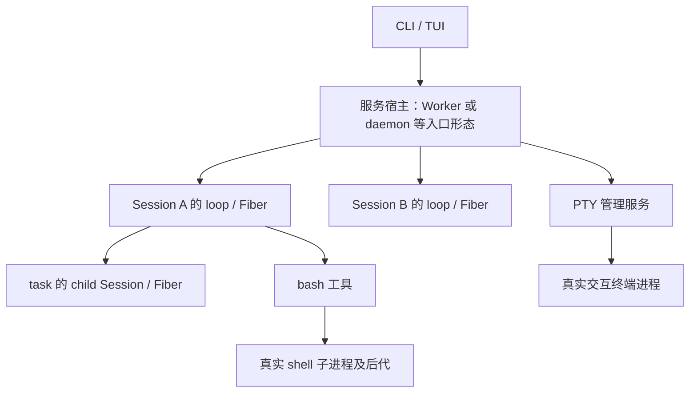

# 05 · 进程、后台任务与 PTY

> [返回学习总览](README.md)。A 为 v1.2.24，B 为固定 dev；有 C 标记时指同一 dev 中的 V2。行号按各自提交计算。

比较基线：v1.2.24 = `c6262f9d40`；当前快照 = `388406238bd5ca15564a762840a2362c3a45bd9c`。以下行号属于相应提交，引用 dev 的地方均指这个固定快照。分析只读，未运行测试；列出的测试是证据和后续阅读入口。

## 先把五种「执行」分开

1. Session 是会话数据/执行身份；子 agent 也通常有一个 child Session，不等于新 OS 进程。
2. Effect Fiber 是 JS/Effect 运行时中可组合、可中断的异步执行单位，不自带 PID；`Effect.forkIn` 不等于 `child_process.fork`。
3. Worker 是 TUI 与服务运行时代码之间的线程/独立 JS isolate 边界；不是每个 agent 都创建 Worker。
4. Bash/shell tool 执行命令时才创建真实 shell 子进程，并可能再有进程组/后代进程。
5. PTY 是带伪终端的交互式 OS 进程，提供输入、resize、持续输出、attach；不是 agent loop，也不是普通 stdout pipe shell tool。

最容易误读：`detached: true` 在这里主要服务于 POSIX 进程组管理。工具仍等待退出/结果，不能据此说它已经「模型侧后台返回」。同样，输出通过 Fiber 流式读取，也不代表工具已经返回。

还要区分 shell 自己的后台命令：`&` 可以启动系统后台进程，但不自动生成 OpenCode 管理的 job ID、观察/取消工具或完成通知。它能否继续存活，要看管道是否仍打开、终端与进程组关系、宿主资源清理等条件。因此本文的“后台 bash 尚未接入”指受管理的模型工具协议，不是说 bash 工具不能运行，也不是说操作系统不支持后台进程。

## 核心对照

| 维度 | v1.2.24 | 当前 V1 | 当前 V2 |
|---|---|---|---|
| shell 入口 | `packages/opencode/src/tool/bash.ts` `BashTool` | `packages/opencode/src/tool/shell.ts` `ShellTool`；暴露工具 ID 仍为 `bash` | `packages/core/src/tool/bash.ts`；独立的 V2 叶子工具 |
| 创建命令 | Node `spawn(command,{shell,cwd,stdio,detached})` | Effect `ChildProcess.make` + 注入 `ChildProcessSpawner` | `ChildProcess.make` + `AppProcess.run` |
| 主体等待 | Promise 监听 exit/error | scoped Effect，同时读取输出，race exit/abort/timeout | scoped Effect 收集 stdout/stderr 和 exitCode；统一 timeout/interruption |
| 默认超时 | 2min，可 flag 改，输入只拒负数 | 2min，可 RuntimeFlags 改，输入只拒负数 | 默认 2min、正整数、上限10min |
| 取消清理 | 手工 AbortSignal listener、timer、`Shell.killTree` | scope + handle.kill，3s 后强杀 | AppProcess scoped，ChildProcess 的 forceKillAfter=3s |
| 输出 | `output += chunk` 累积；metadata 前30k字符 | bounded tail/metadata，超过阈值 full output 落盘，可给 outputPath | 合并输出最多捕获1MiB，结构化 truncated/timeout/exit；当前没有 live progress/全量落盘 |
| 模型调用的 shell 后台参数 | 无独立后台 job 协议 | shell 本身仍等待；另有 task/subagent 后台 | Bash 输入只有 command/workdir/timeout，未提供 background launch |
| 后台 job registry | 此版本不存在 BackgroundJob 文件 | instance-scoped adapter + 共用 core 引擎 | core process-global registry 存在，但不等于已暴露 V2 模型后台 shell/task |
| PTY | Instance.state Map；bun-pty；退出即remove | 服务器已直接复用 core Pty，并补 legacy plugin shell.env | Location-scoped core Pty；Bun/Node 条件实现；保留有限已退出终端供读取 |

## 1. v1.2.24 shell 的完整生命期

源码：`c6262f9d40:packages/opencode/src/tool/bash.ts:78-271`。

- 先解析命令和路径，按 `bash` / `external_directory` 做 `ctx.ask`；然后触发 `shell.env` 插件（167-171）。
- `spawn` 真正创建子进程（172-181），stdin ignore，stdout/stderr pipe，POSIX detached。
- 通过 data listener 把 stdout/stderr 拼到 output；metadata 仅截前30k字符，主 output 仍累加（183-205）。
- 手工注册 `ctx.abort` 与 timeout+100ms；二者走 `Shell.killTree`，再等 exit/error（207-247）。
- 返回时附 `exit`、timeout/user-abort 提示（249-271）。这仍是一次完整前台工具调用：模型要等结果，其他 UI 代码可继续响应。

`c6262f9d40:packages/opencode/src/shell/shell.ts:12-38`：Windows `taskkill /pid PID /f /t`；POSIX 先 `process.kill(-pid,SIGTERM)`，等待200ms 后若没退出发 SIGKILL；进程组失败退到单进程。这里是「取消时尽量清理整棵命令树」，不是进程隔离/沙箱。

## 2. 当前 V1：业务能力保留，执行资源改为 Effect scoped

入口 `dev:packages/opencode/src/tool/shell.ts:338-645`。名字改为 ShellTool，但 `dev:packages/opencode/src/tool/shell/id.ts:14-16` 保留 `ToolID="bash"` 兼容旧插件、权限与用户配置。

执行调用链：`execute`（609）→命令/外部目录权限（620-629）→`run`（631）→ `spawner.spawn`（484）→ scoped output-reader Fiber（486-531）→ `Effect.raceAll(exit,abort,timeout)`（542-546）→必要时 `handle.kill({forceKillAfter:"3 seconds"})`（548-554）→返回结果（585-594）。

改进不是「所有工具都开独立进程」，而是把真实 OS 子进程与输出消费者都挂到资源 scope 上，取消和退出可以统一回收，避免手工 listeners/timers 管理扩散。stdout/stderr 用 handle.all 汇合；超过阈值 full output 落盘（503-513），内存只保留受限尾部（438-446、488-496）和 metadata preview（498）。

平台：Windows PowerShell 显式 `-NoLogo -NoProfile -NonInteractive -Command`、detached false（293-309）；同时增加 PowerShell parser、环境/path处理（311-335 以及 147-217、358-414），不是简单把 Bash 字符串发给所有 shell。

`dev:packages/core/src/cross-spawn-spawner.ts:373-403` 用 acquireRelease 启动/清理进程；killGroup 的 Windows taskkill 与 POSIX -PID 信号见292-311；回收活进程时先 TERM，按 forceKillAfter升级KILL，必要时退到单进程（391-401）。进程成功结束后的释放路径不会无条件追杀所有独立后台后代，因此不能承诺 shell 任意 `nohup/&/setsid` 子孙必然随 Session 结束。

此外，用户直接输入 shell 命令不是 LLM tool：`dev:packages/opencode/src/session/prompt.ts:522-589` 的 shell 路径也用 ChildProcessSpawner、forceKillAfter=3s 和 scoped 管理，但会先合成 user/assistant/tool消息（489-518）。学习时不要把这个入口与模型选择 bash 工具混成一条路径。

## 3. V2：AppProcess 是统一 OS 边界，不是持久化任务调度器

`dev:packages/core/src/process.ts:49-57`：AppProcess.Service 扩展 ChildProcessSpawner，并提供 run / runStream。`node` 是 makeGlobalNode（259）。

- runCommand 内部 `Effect.scoped` + spawn（144-148）。
- combineOutput 时并行消费 all 和 exitCode（149-163）；否则 stdout/stderr/exitCode并行等待（165-180），避免只等退出而堵满管道。
- 可限制 bytes，超过只继续drain而不继续内存增长（121-137）。
- timeout 与 AbortSignal 都在统一封装处理（183-196），离开 scope触发 spawner cleanup。统一返回类型 AppProcessError 带命令、exitCode、stderr、cause（8-19）。
- 非零 exit 本身不被 run 自动判为调用失败；需要 requireSuccess / requireExitIn（59-81）。V2 Bash因而可以把非零退出作为正常结构化工具结果返回，交给模型理解。
- runStream 可输出行、验证允许的退出码和响应AbortSignal（214-253）。

V2 Bash `dev:packages/core/src/tool/bash.ts:158-175` 通过 AppProcess.run 执行真实 shell，取消或超时后等待至多3s再升级强杀、stdout+stderr合并、1MiB捕获上限；超时被转成明确 timeout:true 结果（177-183）。

V2 并非当前 V1 ShellTool 的无损搬迁：文件注释66-77明确列出尚未迁移的 parser/BashArity/Windows特殊处理/plugin shell.env/progress/background能力等债务；实际 Input 23-33没有background。命令参数绝对路径扫描当前只给advisory warning（138-141），workdir外部目录才是结构化external_directory权限（129-137）；且shell执行仍是host user权限，不是沙箱（109）。

现有测试入口：`dev:packages/core/test/process/process.test.ts:154-195` 检验 timeout 与 Fiber interruption 确实使 scoped child 收到TERM并完成清理；输出限额119-142；非零退出与 requireSuccess 在63-109。`packages/core/test/effect/cross-spawn-spawner.test.ts:231-288` 是process control测试。以上是源码/测试静态证据，本报告不宣称已运行这些测试。

## 4. BackgroundJob：后台意味着调用者不再等待，不意味着耐久/独立服务器

核心实现 `dev:packages/core/src/background-job.ts`：

- 113-118 的注释直接限定 scoped/process-local、重启丢失状态、scope关闭中断live work；不存在跨重启接续保证。
- state 是 SynchronizedRef<Map> 和 Scope（120-124）；job执行是 `Effect.forkIn(scope)`（173-187），没有 spawn OS process。
- start 先把running job放入Map再fork（202-251），extend通过previous tail Deferred串行追加（256-287）。
- wait 支持 timeout，但 wait timeout返回 timedOut=true，工作仍运行（292-300），不要和 shell timeout「杀进程」混淆。
- promote 只把metadata.background标记true、发promotion Deferred、运行onPromote（310-334）；不是OS进程迁移。
- cancel标cancelled、完成done Deferred、关闭job scope（337-357）。关闭scope使结构化子任务中断；它不保存可供另一机器继续的任务。
- core node 是global（365）；当前 V1 adapter `dev:packages/opencode/src/background/job.ts:17-35` 又把它包在 InstanceState，所以不同legacy Instance不会共享一个job registry。

当前 V1 task即使前台也先创建BackgroundJob，然后前台调用wait；若后台标志为true则即时返回task_id/jobId，另起notify等待完成再注入synthetic parent prompt（`dev:packages/opencode/src/tool/task.ts:227-264,284-318,328-358`）。因此「前台/后台」是等待与结果送达策略，不是两种不同OS进程。实验性API还可把正在等待的task promote到后台（`dev:packages/opencode/src/server/routes/instance/httpapi/handlers/experimental.ts:159-171`）。

测试明确揭示边界：`dev:packages/core/test/background-job.test.ts:89-104`，owner scope关闭会中断工作，但旧registry读到的状态甚至可能仍是running；它不是durable observation channel，不能据此说任务还活着。

## 5. PTY：与 Bash pipe 执行不同的一条通道

基线：`c6262f9d40:packages/opencode/src/pty/index.ts:93-109` 用Instance.state拥有 Map，dispose时kill所有PTY并关闭订阅。create（120-205）经bun-pty.spawn创建真实交互终端、保存pid，2MiB输出环形缓冲（15,191-195）；退出时直接remove（197-203）。

当前：`dev:packages/core/src/pty.ts:90-133` 变Location-scoped Effect service + finalizer；create165-202仍真实spawn PTY并记录pid；退出223-239记录exitCode并保留有限已退出项，超EXITED_LIMIT后清理；attach259-309使用cursor/replay + pending缓冲 + activate避免历史回放/实时时序丢数据。detach只移除订阅，不是kill进程；remove才teardown。

Bun/Node适配见 `dev:packages/core/package.json` imports #pty，Bun=pty.bun.ts使用bun-pty，Node=pty.node.ts使用@lydell/node-pty。core Pty的Map、输出缓冲及live process仍不跨进程重启保存。当前服务器的PTY handler已直接import core Pty（`dev:packages/opencode/src/server/routes/instance/httpapi/handlers/pty.ts:5`），所以这项不是「V1和V2各维护一份」；legacy plugin shell.env扩展留在handler一侧。

## 6. TUI Worker：从基线就存在，V2并没有首创多线程

基线 `c6262f9d40:packages/opencode/src/cli/cmd/tui/thread.ts:131-140` new Worker，建立Rpc.client；默认经RPC模拟fetch/event，不要求监听TCP（185-195）。停止时先RPC shutdown最多5s，再worker.terminate（155-168）。

当前同样结构见 `dev:packages/opencode/src/cli/cmd/tui.ts:210-249`；worker实现 `dev:packages/opencode/src/cli/tui/worker.ts:30-48` fetch→Server.Default().app.fetch，54-57才按需起server.listen。72-76shutdown dispose instances和server。变化是文件/服务分层重构，并非每个Session/子agent新增Worker。

建议读图：TUI线程 → Worker/RPC中的服务运行时 → 多个Session/Fiber → 个别工具的shell OS进程；PTY另有长期交互式OS进程。V2进一步让Session执行位置由Location决定、用结构化Fiber管控工具，但不能把「Location-aware」「process-global」解读为分布式工作流/崩溃自动恢复都已完成。

## 7. 新 CLI daemon 才是另一个真实宿主进程

V2 相关的新 `packages/cli`（命令名 `lildax`）还有另一种“后台”：daemon 服务进程。它与 task 的后台 Fiber 完全不同。

[B · daemon.ts:110](https://github.com/gaoch023/opencode/blob/388406238bd5ca15564a762840a2362c3a45bd9c/packages/cli/src/services/daemon.ts#L110) 通过 `spawn(process.execPath, [..., 'serve', '--register'], { detached: true, stdio: 'ignore' }).unref()` 启动独立 OS 进程，再用健康/版本检查连接。这里确实多了一个 PID；不是为每个 Session 或子 agent 启一个 daemon。根目录的 `bun dev` 并不直接走这个新 CLI，见 [06](06-entry-migration.md)。

这是执行层次图，Worker 与 daemon 是不同入口形态，不能理解为所有启动方式都会同时创建两者。多个会话共享宿主并不等于共享对话历史；独立历史也不等于文件系统隔离。

## 固定提交源码索引

正文中的短文件名和 `:行号` 延续所在段落的版本与文件。下表按完整路径提供两个提交的入口；“—”表示该路径在该提交中不存在，不能用学习分支中的同名文件代替新版源码。

| 文件 | A · v1.2.24 | B · dev（含最新 V1/V2） |
| --- | --- | --- |
| `packages/core/package.json` | — | [源码](https://github.com/gaoch023/opencode/blob/388406238bd5ca15564a762840a2362c3a45bd9c/packages/core/package.json#L1) |
| `packages/core/src/background-job.ts` | — | [源码](https://github.com/gaoch023/opencode/blob/388406238bd5ca15564a762840a2362c3a45bd9c/packages/core/src/background-job.ts#L1) |
| `packages/core/src/cross-spawn-spawner.ts` | — | [源码](https://github.com/gaoch023/opencode/blob/388406238bd5ca15564a762840a2362c3a45bd9c/packages/core/src/cross-spawn-spawner.ts#L1) |
| `packages/core/src/process.ts` | — | [源码](https://github.com/gaoch023/opencode/blob/388406238bd5ca15564a762840a2362c3a45bd9c/packages/core/src/process.ts#L1) |
| `packages/core/src/pty.ts` | — | [源码](https://github.com/gaoch023/opencode/blob/388406238bd5ca15564a762840a2362c3a45bd9c/packages/core/src/pty.ts#L1) |
| `packages/core/src/tool/bash.ts` | — | [源码](https://github.com/gaoch023/opencode/blob/388406238bd5ca15564a762840a2362c3a45bd9c/packages/core/src/tool/bash.ts#L1) |
| `packages/core/test/background-job.test.ts` | — | [源码](https://github.com/gaoch023/opencode/blob/388406238bd5ca15564a762840a2362c3a45bd9c/packages/core/test/background-job.test.ts#L1) |
| `packages/core/test/effect/cross-spawn-spawner.test.ts` | — | [源码](https://github.com/gaoch023/opencode/blob/388406238bd5ca15564a762840a2362c3a45bd9c/packages/core/test/effect/cross-spawn-spawner.test.ts#L1) |
| `packages/core/test/process/process.test.ts` | — | [源码](https://github.com/gaoch023/opencode/blob/388406238bd5ca15564a762840a2362c3a45bd9c/packages/core/test/process/process.test.ts#L1) |
| `packages/opencode/src/background/job.ts` | — | [源码](https://github.com/gaoch023/opencode/blob/388406238bd5ca15564a762840a2362c3a45bd9c/packages/opencode/src/background/job.ts#L1) |
| `packages/opencode/src/cli/cmd/tui.ts` | — | [源码](https://github.com/gaoch023/opencode/blob/388406238bd5ca15564a762840a2362c3a45bd9c/packages/opencode/src/cli/cmd/tui.ts#L1) |
| `packages/opencode/src/cli/cmd/tui/thread.ts` | [源码](https://github.com/gaoch023/opencode/blob/c6262f9d4002d86a1f1795c306aa329d45361d12/packages/opencode/src/cli/cmd/tui/thread.ts#L1) | — |
| `packages/opencode/src/cli/tui/worker.ts` | — | [源码](https://github.com/gaoch023/opencode/blob/388406238bd5ca15564a762840a2362c3a45bd9c/packages/opencode/src/cli/tui/worker.ts#L1) |
| `packages/opencode/src/pty/index.ts` | [源码](https://github.com/gaoch023/opencode/blob/c6262f9d4002d86a1f1795c306aa329d45361d12/packages/opencode/src/pty/index.ts#L1) | — |
| `packages/opencode/src/server/routes/instance/httpapi/handlers/experimental.ts` | — | [源码](https://github.com/gaoch023/opencode/blob/388406238bd5ca15564a762840a2362c3a45bd9c/packages/opencode/src/server/routes/instance/httpapi/handlers/experimental.ts#L1) |
| `packages/opencode/src/server/routes/instance/httpapi/handlers/pty.ts` | — | [源码](https://github.com/gaoch023/opencode/blob/388406238bd5ca15564a762840a2362c3a45bd9c/packages/opencode/src/server/routes/instance/httpapi/handlers/pty.ts#L1) |
| `packages/opencode/src/session/prompt.ts` | [源码](https://github.com/gaoch023/opencode/blob/c6262f9d4002d86a1f1795c306aa329d45361d12/packages/opencode/src/session/prompt.ts#L1) | [源码](https://github.com/gaoch023/opencode/blob/388406238bd5ca15564a762840a2362c3a45bd9c/packages/opencode/src/session/prompt.ts#L1) |
| `packages/opencode/src/shell/shell.ts` | [源码](https://github.com/gaoch023/opencode/blob/c6262f9d4002d86a1f1795c306aa329d45361d12/packages/opencode/src/shell/shell.ts#L1) | — |
| `packages/opencode/src/tool/bash.ts` | [源码](https://github.com/gaoch023/opencode/blob/c6262f9d4002d86a1f1795c306aa329d45361d12/packages/opencode/src/tool/bash.ts#L1) | — |
| `packages/opencode/src/tool/shell.ts` | — | [源码](https://github.com/gaoch023/opencode/blob/388406238bd5ca15564a762840a2362c3a45bd9c/packages/opencode/src/tool/shell.ts#L1) |
| `packages/opencode/src/tool/shell/id.ts` | — | [源码](https://github.com/gaoch023/opencode/blob/388406238bd5ca15564a762840a2362c3a45bd9c/packages/opencode/src/tool/shell/id.ts#L1) |
| `packages/opencode/src/tool/task.ts` | [源码](https://github.com/gaoch023/opencode/blob/c6262f9d4002d86a1f1795c306aa329d45361d12/packages/opencode/src/tool/task.ts#L1) | [源码](https://github.com/gaoch023/opencode/blob/388406238bd5ca15564a762840a2362c3a45bd9c/packages/opencode/src/tool/task.ts#L1) |
