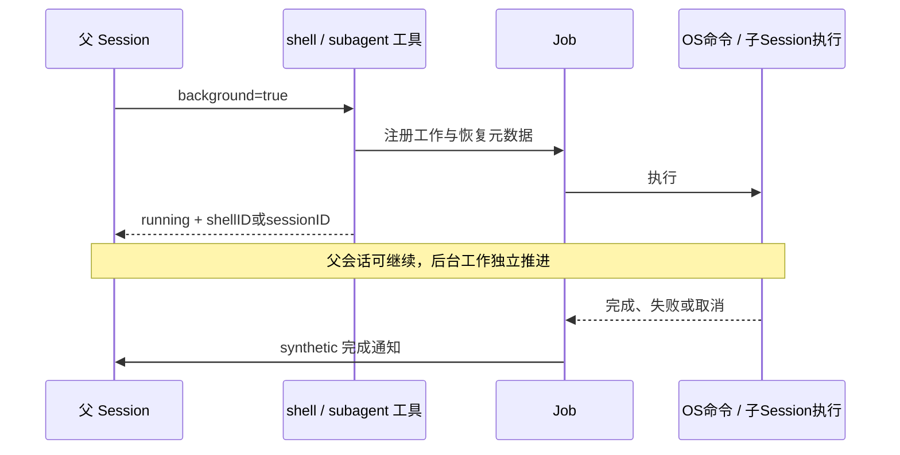

# 07 · 当前 V2：子 agent、shell 前后台与 Job 恢复

> [返回学习总览](README.md)。当前 Session/loop 的其他变化见 [08](08-current-session.md)。

本篇固定在当前远端 dev **`62c9002819d06dd48b673a1f84e94ce3e51e50e0`**，提交日期 2026-10-22，根 package.json 版本 **2.1.3**。先前 `388406238bd5ca15564a762840a2362c3a45bd9c` 的缺功能结论只属于旧快照，不能描述本篇版本。

本次为源码和现有测试的静态审查，未执行测试或真实模型请求。

## 1. 不只是定义存在，默认入口已接上

- 根 `package.json:10` 的 `bun dev` 已运行 `packages/cli`；旧 `packages/opencode` 包已从当前树移除。
- [`packages/core/src/plugin/internal.ts:247,249`](https://github.com/gaoch023/opencode/blob/62c9002819d06dd48b673a1f84e94ce3e51e50e0/packages/core/src/plugin/internal.ts#L247) 的内置 pre 插件表同时包含 **ShellTool.Plugin** 和 **SubagentTool.Plugin**；`:281-295` 将这些插件提供给运行时。
- 新工具叫 **`subagent`**，定义在 [`packages/core/src/tool/plugin/subagent.ts:17`](https://github.com/gaoch023/opencode/blob/62c9002819d06dd48b673a1f84e94ce3e51e50e0/packages/core/src/tool/plugin/subagent.ts#L17)；`:100-108` 通过 `ctx.tool.transform → editor.add` 注册真正 execute。
- 因此“旧 `task.ts` 找不到”不能解释为没有子 agent：架构和工具名都已经迁移。

## 2. 输入、输出与前后台能力

`subagent.ts:29-54`：

| 字段 | 含义 |
| --- | --- |
| agent | 指定子 agent 身份；必须存在且不能是 primary-only agent |
| description / prompt | UI 标签与交给子会话的工作内容 |
| model | 可选的明确模型/variant 覆盖，代码校验可用性 |
| sessionID | 继续已有子会话，省略则创建新子会话 |
| background | true 时立即返回 running，完成后自动通知父会话 |
| 输出 | sessionID、status=completed/running、output |

后台参数在当前工具中直接可见，execute 没有旧 V1 的 `OPENCODE_EXPERIMENTAL_BACKGROUND_SUBAGENTS` 开关判断。不要沿用旧版本的开关要求。

## 3. 权限、深度与父子身份

- `subagent.ts:110-133` 获取父 Session，沿 parentID 数祖先；读取 `experimental.subagent_depth`，默认 **1**。默认允许主会话派一层子会话，不代表任意递归。
- `:134-137` resolve agent，并拒绝 `mode === 'primary'`。
- `:138-151` 执行 `permission.assert({ action:'subagent', resources:[agent.id], sessionID:父ID, agent:调用者, source:工具调用 })`，不是只有描述中做过滤。
- `:153-167` 继续已有 Session 时检查 `existing.parentID === context.sessionID`；不能拿任意别人的 Session ID 当子任务续接。
- `:184-198` 新会话由 `sessions.create({ parentID, title, agent, model })` 创建。
- [`packages/core/src/session.ts:279-302`](https://github.com/gaoch023/opencode/blob/62c9002819d06dd48b673a1f84e94ce3e51e50e0/packages/core/src/session.ts#L279) 进一步表明 child 继承父 Location，默认继承 metadata 和 Session permissions；没有复制整段父对话历史。
- 可用子 agent 列表由 `subagent.ts:282-309` 的 session context/compaction/generate hooks 注入描述，排除 primary/hidden 与被父/调用者 agent 的 subagent 权限规则 deny 的身份。

## 4. 模型选择与续接切换

`subagent.ts:75-98` 解析 model reference，确认 provider/model 在 available 集合，variant 也必须存在。

新建子会话的模型优先级（`:184`）为：**显式 model → 子 agent 配置模型 → 父 Session 模型**。

继续已有会话时（`:168-181`）：

- agent 变更会调用 switchAgent。
- 显式 model 总是优先；若切了 agent 且该 agent 有配置模型，则切到该模型。
- 没有显式覆盖、agent 也没变时保留子会话原模型，避免每次续接都被父模型覆盖。

`model` 的提示词约束是仅用户明确要求时设置；它不等于代码阻止调用方传入任意可用模型。

## 5. 一条完整的执行链

```text
父模型调用 subagent
  → 深度/agent/权限校验
  → 创建或验证直属 child Session
  → child prompt admission
  → SubagentJob.start(recovery)
      → Job.start(id=childID)
      → sessions.resume(childID)
      → 取最近 completed、无 error 的 assistant 文本
  ├─ 前台：jobs.block → completed 输出给本次工具调用
  └─ 后台：jobs.background + 注册 observer → running 立即返回
                                         → 完成后 synthetic 输入通知父会话
```

- admission 在 job 之外（`subagent.ts:203-218`）：已有 running job 的 start 会 join/跳过自己的 run effect，但追加 prompt 仍能送达正在执行的 child。
- 新建后台 child 的首次 prompt 使用 `resume:false`，再由 Job 所有的 resume 执行，见 `:212`。
- `:220-227` 保存 kind=subagent、parentSessionID、childSessionID、agent、description 的恢复元数据并启动 job。
- `:229-231` 是明确的立即返回路径；不是仅在 shell 里使用 `&`。
- 前台也可被转后台：`:234-243` 的 jobs.block 返回 backgrounded 时解除等待并注册通知，不重新创建一个 child。

## 6. 取消与完成通知的作用域

前台等待被 interrupt 时，`subagent.ts:234-239` 同时执行 **sessions.interrupt(childID)** 和 **jobs.cancel(childID)**。失败或取消会保留子 Session ID 给模型，便于后续明确续接（`:245-255`）。

[`packages/core/src/session/subagent-job.ts:24-41`](https://github.com/gaoch023/opencode/blob/62c9002819d06dd48b673a1f84e94ce3e51e50e0/packages/core/src/session/subagent-job.ts#L24) 把执行与完成观察放到全局服务作用域，避免启动插件重载、父 Location 驱逐或 child 移动后丢失通知。observer 以 childID+startedAt 去重。

`subagent-job.ts:45-66` 管 start/background；[`packages/core/src/session/subagent-completion.ts:21-45`](https://github.com/gaoch023/opencode/blob/62c9002819d06dd48b673a1f84e94ce3e51e50e0/packages/core/src/session/subagent-completion.ts#L21) 将 completed/error/cancelled 包装成 `<subagent ...>`，用 **sessions.synthetic** 注入父 Session，随后确认 durable notification 已送达。

后台 tool call 已返回后，其工作不再依附原工具调用的同步等待。不能直接沿用旧 V1 的“取消父会话必递归取消所有后台后代”结论：当前明确可见的是前台 onInterrupt 传播、Job.cancel、子 Session interrupt；父 Session 普通 interrupt 经 `session/session.ts:325-327` 调 SessionExecution，并不是在这里遍历所有 descendants。

## 7. 当前已经有受限重启恢复

[`packages/core/src/job.ts:173-177`](https://github.com/gaoch023/opencode/blob/62c9002819d06dd48b673a1f84e94ce3e51e50e0/packages/core/src/job.ts#L173) 说明 registry 仍是 process-local，但可恢复后台工作持有 durable notification marker；`:199-208` 将 recovery/status/output/error 存入 KV。

[`packages/core/src/session/execution/restart.ts:138-188`](https://github.com/gaoch023/opencode/blob/62c9002819d06dd48b673a1f84e94ce3e51e50e0/packages/core/src/session/execution/restart.ts#L138)：

1. 读取 child，验证 child-parent 关系和父会话仍存在。
2. 若任务已结束，只补送尚未确认的完成通知。
3. 若仍 running 且没有本进程 owner，调用 prepareResume 检查恢复预算。
4. 重建 Job，以 execution.resume(childID) 从持久会话继续，等待结果并通知父会话。

这不是恢复同一个 Fiber 或旧 OS PID。对 shell，`:101-135` 则把重启时尚 running 的命令标为 cancelled 并通知；不会假定旧外部命令能无缝接续。不能把“子会话可继续”“通知可恢复”“外部副作用 exactly-once”混成同一保证。

## 8. 适合从 v1.2.24 跟读的对应关系

| v1.2.24 | 当前 V2 |
| --- | --- |
| task.execute | tool/plugin/subagent.ts 的插件工具 execute |
| Session.create(parentID) | 同一父子概念保留，默认 Location/Session 权限继承明确化 |
| await SessionPrompt.prompt(child) | prompt admission + SubagentJob → Job → Session.resume |
| AbortSignal 监听后 child cancel | Effect onInterrupt + Session.interrupt + Job.cancel |
| task_result 返回文本 | completed 工具结果，或后台 synthetic 完成输入 |
| 无专用后台参数 | background=true、前台转后台、generation 通知去重与恢复 marker |

现有测试入口（本次未运行）：[`packages/core/test/tool-subagent.test.ts:404`](https://github.com/gaoch023/opencode/blob/62c9002819d06dd48b673a1f84e94ce3e51e50e0/packages/core/test/tool-subagent.test.ts#L404) 前台 child 最终文本；`:523` steer 正运行后台 child；`:766` 后台完成只通知一次；[`packages/core/test/subagent-lifetime.test.ts:55-145`](https://github.com/gaoch023/opencode/blob/62c9002819d06dd48b673a1f84e94ce3e51e50e0/packages/core/test/subagent-lifetime.test.ts#L55) child 移动、父 Location 驱逐后仍恰好一次通知。


## 9. Shell 后台是实际工具能力


`packages/core/src/tool/plugin/shell.ts`：

- `:23` 工具名 **shell**（不再是旧 bash 名）
- `:48-61` 输入 command/workdir/timeout/**background**
- `:55` timeout=0 禁用超时；后台默认不设超时
- `:191-199` editor.add 注册
- `:201` 按前后台选择默认 timeout
- `:203-219` shell.create 实际启动
- `:239-252` Job.start，带 kind:shell 的 recovery 元数据
- `:254-257` jobs.background、notifyWhenDone、立即返回 shellID/输出文件/running
- `:260-266` 前台 jobs.block，收到 backgrounded 时移后台并去掉超时
- `:157-188` 完成后 sessions.synthetic 注入输出与终态；不是仅支持 shell 的 `&`

测试静态证据：[`packages/core/test/tool-shell.test.ts:1557`](https://github.com/gaoch023/opencode/blob/62c9002819d06dd48b673a1f84e94ce3e51e50e0/packages/core/test/tool-shell.test.ts#L1557) returns the shell id for a background command；`:1609` preserves non-zero exit；`:1647` persists a silent command that finishes before backgrounding；`:1813` foreground command backgrounded when session signaled。


### Shell 的管理接口也已经接入

[`packages/protocol/src/groups/shell.ts:8`](https://github.com/gaoch023/opencode/blob/62c9002819d06dd48b673a1f84e94ce3e51e50e0/packages/protocol/src/groups/shell.ts#L8) 与 [`packages/server/src/handlers/shell.ts:9`](https://github.com/gaoch023/opencode/blob/62c9002819d06dd48b673a1f84e94ce3e51e50e0/packages/server/src/handlers/shell.ts#L9) 提供以下 HTTP API：

| 操作 | 路径 | 语义 |
| --- | --- | --- |
| list | GET `/api/shell` | 当前 Location 仍在运行的命令 |
| create | POST `/api/shell` | 启动非交互命令，捕获输出到文件 |
| get | GET `/api/shell/:id` | 命令状态和退出信息 |
| output | GET `/api/shell/:id/output` | 按 byte cursor 分页读输出 |
| remove | DELETE `/api/shell/:id` | 终止并移除命令及保留输出 |

[`packages/protocol/src/groups/session.ts:706`](https://github.com/gaoch023/opencode/blob/62c9002819d06dd48b673a1f84e94ce3e51e50e0/packages/protocol/src/groups/session.ts#L706) 的 POST `/api/session/:sessionID/background` 还能将会话正在等待的可后台化工具转到后台观察，idle 时 no-op。对应 handler 在 [`packages/server/src/handlers/session.ts:597`](https://github.com/gaoch023/opencode/blob/62c9002819d06dd48b673a1f84e94ce3e51e50e0/packages/server/src/handlers/session.ts#L597)。

应用层的 HTTP 管理接口与模型直接看到的工具目录是两层，不能把上述 API 都说成模型默认可用的同名工具。当前内置 shell 的完成回注是自动通知，不是要求模型反复轮询输出文件。

## 10. 用前后台时间线连接基线概念



上图是生命周期概念图，不表示两种工具的资源启动顺序完全相同：shell 实际先 Shell.create 启动进程，再注册 Job；子 agent 的执行则由 Job 中的 resume 推进。

基线 task 的核心是 child Session + await loop；当前增加 Job、后台观察、持久通知确认和恢复。基线 bash 的核心是 OS spawn + 监听输出/abort/timeout；当前将命令变成带 shellID、输出文件和管理接口的资源，再决定工具调用者是否同步等待。

shell 的 `background:true` 已有 OpenCode 管理协议，不能与命令中手写 `&` 混为一谈。子 agent 仍主要是同服务进程中的异步会话执行，不是每次派生就创建一个 OS 进程。

本篇仅静态核查默认注册、执行链和现有测试，不声称新依赖已安装或这些测试已运行。


## 当前固定提交源码索引

短文件名与 `:行号` 延续所在段落的源文件；以下链接均固定到当前 N 提交。

| 文件 | 源码 |
| --- | --- |
| `packages/core/src/job.ts` | [N 源码](https://github.com/gaoch023/opencode/blob/62c9002819d06dd48b673a1f84e94ce3e51e50e0/packages/core/src/job.ts#L1) |
| `packages/core/src/plugin/internal.ts` | [N 源码](https://github.com/gaoch023/opencode/blob/62c9002819d06dd48b673a1f84e94ce3e51e50e0/packages/core/src/plugin/internal.ts#L1) |
| `packages/core/src/session.ts` | [N 源码](https://github.com/gaoch023/opencode/blob/62c9002819d06dd48b673a1f84e94ce3e51e50e0/packages/core/src/session.ts#L1) |
| `packages/core/src/session/execution/restart.ts` | [N 源码](https://github.com/gaoch023/opencode/blob/62c9002819d06dd48b673a1f84e94ce3e51e50e0/packages/core/src/session/execution/restart.ts#L1) |
| `packages/core/src/session/subagent-completion.ts` | [N 源码](https://github.com/gaoch023/opencode/blob/62c9002819d06dd48b673a1f84e94ce3e51e50e0/packages/core/src/session/subagent-completion.ts#L1) |
| `packages/core/src/session/subagent-job.ts` | [N 源码](https://github.com/gaoch023/opencode/blob/62c9002819d06dd48b673a1f84e94ce3e51e50e0/packages/core/src/session/subagent-job.ts#L1) |
| `packages/core/src/shell.ts` | [N 源码](https://github.com/gaoch023/opencode/blob/62c9002819d06dd48b673a1f84e94ce3e51e50e0/packages/core/src/shell.ts#L1) |
| `packages/core/src/tool/plugin/shell.ts` | [N 源码](https://github.com/gaoch023/opencode/blob/62c9002819d06dd48b673a1f84e94ce3e51e50e0/packages/core/src/tool/plugin/shell.ts#L1) |
| `packages/core/src/tool/plugin/subagent.ts` | [N 源码](https://github.com/gaoch023/opencode/blob/62c9002819d06dd48b673a1f84e94ce3e51e50e0/packages/core/src/tool/plugin/subagent.ts#L1) |
| `packages/core/test/subagent-lifetime.test.ts` | [N 源码](https://github.com/gaoch023/opencode/blob/62c9002819d06dd48b673a1f84e94ce3e51e50e0/packages/core/test/subagent-lifetime.test.ts#L1) |
| `packages/core/test/tool-shell.test.ts` | [N 源码](https://github.com/gaoch023/opencode/blob/62c9002819d06dd48b673a1f84e94ce3e51e50e0/packages/core/test/tool-shell.test.ts#L1) |
| `packages/core/test/tool-subagent.test.ts` | [N 源码](https://github.com/gaoch023/opencode/blob/62c9002819d06dd48b673a1f84e94ce3e51e50e0/packages/core/test/tool-subagent.test.ts#L1) |
| `packages/protocol/src/groups/session.ts` | [N 源码](https://github.com/gaoch023/opencode/blob/62c9002819d06dd48b673a1f84e94ce3e51e50e0/packages/protocol/src/groups/session.ts#L1) |
| `packages/protocol/src/groups/shell.ts` | [N 源码](https://github.com/gaoch023/opencode/blob/62c9002819d06dd48b673a1f84e94ce3e51e50e0/packages/protocol/src/groups/shell.ts#L1) |
| `packages/server/src/handlers/session.ts` | [N 源码](https://github.com/gaoch023/opencode/blob/62c9002819d06dd48b673a1f84e94ce3e51e50e0/packages/server/src/handlers/session.ts#L1) |
| `packages/server/src/handlers/shell.ts` | [N 源码](https://github.com/gaoch023/opencode/blob/62c9002819d06dd48b673a1f84e94ce3e51e50e0/packages/server/src/handlers/shell.ts#L1) |
