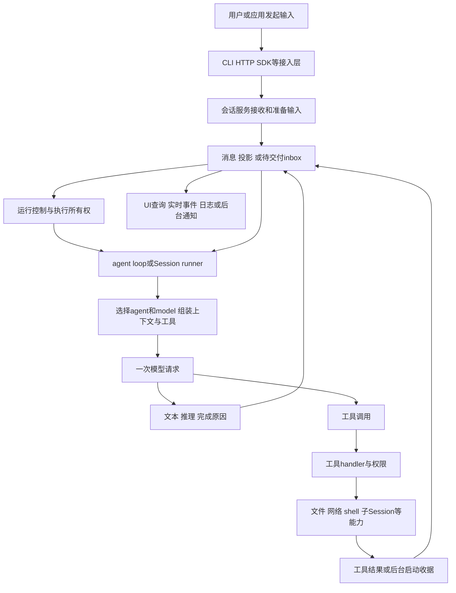

# 00 · 先建立坐标：读懂一个 coding agent 要分哪几层

这不是 API 名称清单。目标是让你能从输入一路追到模型、工具、数据与进程，遇到并发、取消、后台完成或崩溃时，仍能解释系统为什么进入那个状态。后续各版本都按自己的实现完整讲一遍，再横向比较。

本书涉及的“新版”都固定到本次同步的提交，不用目录里出现 v2、SDK 路径版本或包拆分数量猜架构。A=v1.2.24；B=V2 推广前最终 V1 1.18.35；N=2026-10-29 的 V2 2.2.0。详细 SHA 见总览。

## 1. 一张有因果关系的地图

这张图是跨版本概念图，不表示三个版本有相同的 API、表和持久承诺。A/B 直接保存用户消息，N 有明确 inbox；A/B 默认借 SDK 工具回调，N 的 step 拥有工具运行；实时事件也不天然等于完整历史日志。

关键不是记箭头数量，而是沿每根箭头提问：交付了什么数据？发生前后谁拥有它？这一步失败会留下什么？如果响应丢了，再请求一次算新意图还是重试？这些答案决定系统的可靠性与可调试性。

## 2. 同一句“agent 正在运行”，可能藏着十种对象

| 对象 | 作用与例子 | 最常见的误解 |
| --- | --- | --- |
| Agent | build/explore 等策略身份：指令、模型偏好、权限、步骤额度 | 名字代表一个常驻线程或进程 |
| Model | provider/model/variant 及其调用能力 | 换 agent 一定换模型，或反过来 |
| Session | 保存对话身份、历史、位置、父子关系等 | Session 存在就一直有模型在跑 |
| Input | 一次用户或系统提交的新意图 | HTTP 收到就代表模型已看见 |
| Message/Part | assistant、文本、工具调用等可查询记录 | 一条消息只能是一个字符串 |
| Step/Attempt | N 的逻辑模型步骤与实际尝试 | 工具数量、模型请求数、用户轮次相等 |
| Runner/Coordinator | 决定同会话由谁推进、何时再查工作 | 任意多进程共享数据库就自然有分布式锁 |
| Tool call | 模型选择的一次能力调用 | 记录调用事实就已经执行了副作用 |
| Job | 管理工作、等待、后台化、终态与通知 | 有 job ID 就意味着持久进程永不丢失 |
| OS process/PTY | 真正有 PID 的命令或带伪终端的交互资源 | 每个子 agent 都对应一个这样的进程 |

一个例子可以同时拥有它们：父 Session P 以 build 身份调用模型，模型用 subagent 创建 explore 子会话 C，又用 shell 启动测试进程 H。P/C 的历史不同，但可能仍操作同一个目录；Job 管理等待与通知；H 才有实际 PID。你看到“父 agent 在忙”，必须进一步说明是哪段执行、哪个步骤、哪种外部资源在忙。

## 3. 状态至少分四层，不能互相替代

**持久业务状态。** 用户输入、消息、工具结果、pending inbox、claim、instruction blobs 或 recovery marker。它回答过去发生了什么以及以后应处理什么；具体哪些内容保留，以版本和宿主配置为准。

**活跃执行状态。** callbacks、Deferred、Fiber、Map 中 owner、进程句柄、网络连接。它回答本进程此刻在推进什么；不会因为你把 Session 存进 SQLite，就自动保存这些活对象。

**观察状态。** SSE、live delta、界面 spinner、通知队列、正在等待的 HTTP 请求。它回答某个观察者现在知道什么；观察者断开与工作是否结束没有必然等价关系。

**外部世界状态。** 已经写入的文件、已发出的 API 请求、测试进程与远端 provider 收到的请求。它可能先于本地结果保存改变，因此“本地没有成功记录”不能推出“外部没有执行”。这是理解取消与崩溃恢复的根本限制。

以后看到一个“持久化”改进，要问它解决的是哪层的不确定性。后台通知持久化解决了通知可补交，不意味着原 PID 存活；claim 帮助发现未终结执行，不意味着外部副作用 exactly-once。

## 4. Effect 只需要先理解这几个具体动作

- `Effect.Effect<A,E,R>` 是待运行的计算描述，成功值 A、类型化错误 E、所需服务 R；拿到它不等于已经执行。
- `yield* Some.Service` 取当前运行 context 中的服务；不是创建一个名为 Some 的任务。
- `Layer` 构建依赖与资源。它回答谁提供数据库、文件系统或权限；不应该每个 Session 都随意重建整套世界。
- `Fiber` 是活动异步计算，能够等待、组合和中断；不等于 OS 线程。
- `Scope` 是资源归属和回收边界；finalizer 可以关闭资源，但不能撤回已经发生的远端副作用。
- `Deferred` 是一次性结果信号；多个等待者等同一 owner 的结果，不必再起一个 owner。
- `forkIn`/`forkScoped` 把活动执行绑定到某个 scope。看到 fork 后先问归谁管，再问是否并行，最后才问是否构成用户可见后台功能。
- `orDie` 把类型化错误转成 defect，不等于忽略错误；`uninterruptibleMask` 也不等于整个函数不可取消，它可以显式 restore 一部分操作。

本书不要求你先学完 Effect 才看 OpenCode。第 02 章把这些词放进真正的 Runner 和 SDK 回调边界，第 03、04 章再展示它们怎样组织服务、工具和后台通知。

## 5. 每个版本按同样的问题读，但不要硬找同名函数

先回答七个问题：输入在哪里落下；谁拥有活动执行；怎样组装模型请求；模型怎样触发工具；结果怎样进入下次上下文；何时继续/结束；取消或崩溃怎样收尾。A 在较集中的 prompt/processor/llm 中回答，B 加入服务与运行状态机，N 将多个生命周期边界重新分开。

你不必先记住最新版所有路径。先在 A 画出闭环，再读 B 的控制与资源工程化，最后读 N 的新契约。这样当一个函数移动到别的包、工具换名或字段改变时，你仍能根据职责找到它，而不是认为功能消失。

## 6. 本书的代码与推演怎样核对

正文源码片段由完整 SHA、路径和行范围自动提取。它们是原文截取，不是为讲解重写的伪实现；缺少前后 import 或局部定义时，不能把单个片段当成可独立运行的程序。在线链接可查看完整上下文，下载包另提供被引用文件的完整源码和离线行号页。

状态时间线、项目路径、测试结果与短 ID 则明确属于教学推演。它们帮助把真实实现串成因果链，不冒充运行过 provider 的日志。本书核验源码和文档产物，不声称每个版本的全套运行测试已通过。

对于“V2 为什么存在”，第 06 章把仓库明确表达的目标、从实现推导的收益和需要测量才能回答的问题分开。你可以验证多窗口事件编码少做了哪些重复工作，但不能仅凭源码就给整体速度或费用写一个百分比。
