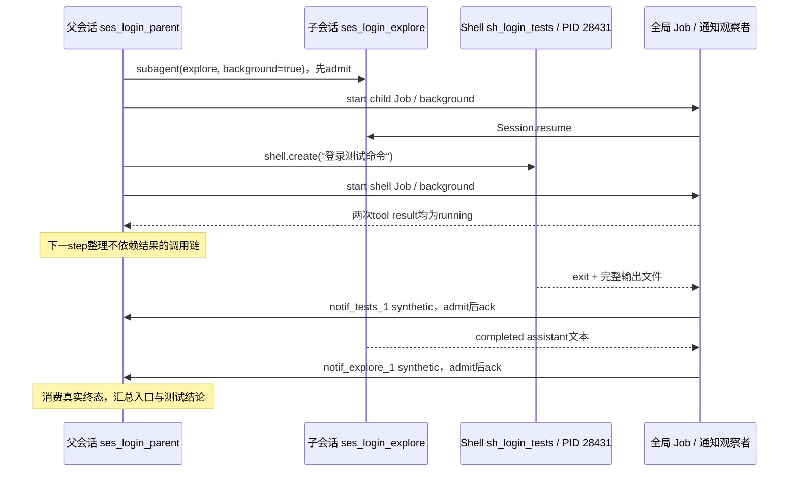

# 04 · V2 的工具、子 agent、shell 与执行资源

本章固定读取 **N=`726cf096396d5014c3b1845e231cc01efe0421ee`** ，根版本 **2.2.0** 。这里的“当前”只指 N，所有源码片段都从该提交展开。v1.2.24 的 `task`、`bash` 是理解出发点；N 中相应能力主要由 `subagent`、`shell`、`Job` 以及插件工具系统承担。它们已经实装，不能沿用推广前快照中“V2 尚未接入”的结论。

我们始终追踪同一个任务：用户要求“读登录代码，让 explore 找到认证入口，后台跑登录测试；等待期间继续整理调用链，最后汇总结果”。这个任务看起来只有一句话，实际同时涉及父会话、子会话、模型请求、工具调用、系统命令和结果通知。读懂它的关键，是知道每一层到底拥有什么身份、等待谁、在何处取消、何种状态能在重启后重新找到。

## 1. 先给所有执行单位一个准确位置

Agent 是一套策略身份，包含模型偏好、提示词、模式和权限。Session 是一段会话的身份、输入与历史。模型在某次 step 中产生 tool call，OpenCode 为这次调用执行工具。工具可能只读取一个文件，也可能启动一段新的 Session，还可能启动真实 OS 进程。这些不是同一种资源。

Effect Fiber 管理可组合、可中断的异步计算。它没有独立 PID，不等于操作系统线程。`subagent` 会让另一个 Session 推进自己的模型循环，通常仍在同一个服务进程中。`shell` 则通过进程适配器启动系统 shell，后者才有真实 PID。Job 负责工作的等待、前后台转换、状态与完成通知；它可以管理子 Session，也可以管理等待命令结束的计算，但 Job 本身不是一个 OS 进程。

| 身份 | 本例中的示意值 | 归属与用途 |
| --- | --- | --- |
| 父 Session | `ses_login_parent` | 用户这次登录分析的对话历史 |
| 子 Session | `ses_login_explore` | explore 自己的输入、模型调用与回复 |
| assistant message | `msg_parent_07` | 父模型这一轮输出及其工具调用 |
| tool call | `call_explore`、`call_tests` | 区分同一 assistant 发出的两次调用 |
| shellID | `sh_login_tests` | 非交互命令资源、输出文件和状态 |
| Job ID | 子会话 ID 或 shellID | 选择具体工作来等待、转后台或取消 |
| notificationID | `notif_explore_1`、`notif_tests_1` | 一次后台完成通知的稳定输入身份 |
| PID | 例如 `28431` | OS 中实际测试命令进程的身份 |

这些值仅为教学示意，不是本次运行产生的结果。不能把 `call_tests` 当成 shellID，也不能因为 Job ID 使用子 Session ID，就认为 Job 与 Session 是同一数据结构。复用应用身份，是为了关联资源；每层仍有不同的所有者和生命周期。

本地部署的大体层次是：客户端连接服务进程，服务进程内运行多个 Session/Fiber，个别工具启动 shell 进程。交互终端走 PTY 通道；持久终端还可能由独立的 `opencode-pty` daemon 持有。Worker 在 N 中也存在，但图像处理 Worker 与子 agent 调度不是同一条链。

## 2. 一个工具如何从插件变成模型能调用的能力

先纠正旧版本学习者容易带来的想象：模型没有直接访问 `Shell.Service` 或 `Session.Service`。它只看到当前请求提供的工具定义，并输出工具名及 JSON 参数。OpenCode 必须把“模型能看见的描述”与“宿主允许执行的代码”接起来。这条连接经过插件注册、工具状态快照、请求上下文调整、参数校验、实际处理和结果结算。

N 的 `packages/core/src/plugin/internal.ts:253,255` 默认注册 `ShellTool.Plugin` 与 `SubagentTool.Plugin`。每个插件取得 `ctx`，用 `ctx.tool.transform(editor => editor.add(...))` 增加定义。一个定义含 name、description、input、output、options 和 execute。`Tool` 服务保存这些定义及已经转换过的模型 schema。旧文中可把这一阶段叫 materialize； **N 的实际 API 名叫 `snapshot`** ，读源码要搜当前符号。

<!-- EXCERPT 726cf096396d5014c3b1845e231cc01efe0421ee packages/core/src/tool.ts 249 274 -->
**真实源码 · N · V2 2.2.0** — [`packages/core/src/tool.ts`，L249–L274](https://github.com/gaoch023/opencode/blob/726cf096396d5014c3b1845e231cc01efe0421ee/packages/core/src/tool.ts#L249-L274)

```typescript
      snapshot: Effect.fn("Tool.snapshot")((permissions) =>
        Effect.sync(() => {
          const data = state.get()
          const active = new Map<string, Tool.Info>()
          const rules = permissions ?? []
          for (const [name, tool] of data.tools) {
            if (whollyDisabled(tool.options?.permission ?? name, rules)) continue
            active.set(name, tool)
          }
          const codeModeEnabled = !whollyDisabled("execute", rules)
          // Without Code Mode its tools would be unreachable, so expose them as direct tools instead.
          const direct = codeModeEnabled
            ? new Map(Array.from(active).filter(([, tool]) => tool.options?.codemode === false))
            : active
          const codeModeTools = new Map(Array.from(active).filter(([, tool]) => tool.options?.codemode !== false))
          const names = Array.from(codeModeTools.keys()).join("\0")
          // Discovery is immutable for a registry revision and visible tool set. Keep executors
          // fresh, but share the inventory, whose prepared runtime and much larger rendered catalog
          // are cached by identity, and the execute tool's definition across steps.
          const cached = catalog?.data === data && catalog.names === names ? catalog : undefined
          const codeModeInventory = cached?.inventory ?? { tools: codeModeTools, namespaces: data.namespaces }
          const codeModeTool = codeModeEnabled
            ? CodeModeTool.create(codeModeInventory, (name, tool, input, context) =>
                beforeExecute(name, input, context).pipe(
                  Effect.flatMap((event) => executeTool(tool, name, event.input, context)),
                ),
```

这段代码先按当前权限规则过滤完全禁用的工具，再把直接工具与 CodeMode 工具分开。`subagent`、`shell` 的 `codemode:false` 表示它们作为直接工具暴露；其他能力可能通过 `execute` 所提供的 CodeMode 目录调用。看到目录中没有某个顶层工具名，不能立刻断言实现不存在，还要看它是否被收进 CodeMode，以及请求上下文是否隐藏了它。

snapshot 固定当前工具集合及执行关联，避免模型拿着某个描述，执行时却意外换成另一份定义。代码还缓存同一 registry revision、同一可见集合的 CodeMode inventory 与 definition，减少重复构建；这是能从实现直接确认的工作复用，不是可以据此编造的延迟百分比。快照并非绕过动态权限：工具执行时仍要检查当前调用者、具体路径、资源与用户决定。

`snapshot.execute` 会构造包括 sessionID、agent、messageID、call ID、progress 的上下文，先执行 `execute.before` hook，再确认工具没有被当前请求撤下或别名解析到未知定义。随后执行器检查参数 schema，调用真正的处理函数，再按 output schema 编码输出。

<!-- EXCERPT 726cf096396d5014c3b1845e231cc01efe0421ee packages/core/src/tool/runtime.ts 29 60 -->
**真实源码 · N · V2 2.2.0** — [`packages/core/src/tool/runtime.ts`，L29–L60](https://github.com/gaoch023/opencode/blob/726cf096396d5014c3b1845e231cc01efe0421ee/packages/core/src/tool/runtime.ts#L29-L60)

```typescript
export const execute = (tool: Tool.Info<any, any>, input: unknown, context: Tool.Context) =>
  Effect.gen(function* () {
    const decoded = yield* decodeInput(tool, input)
    // Tool implementations declare `Tool.Error` but plugins can fail with anything at
    // runtime. A foreign typed failure would slip past every `catchTag("Tool.Error")`
    // downstream and leave its call permanently unsettled, so the declared contract is
    // enforced here at the untrusted boundary. Declines tunnel through as defects and
    // interrupts are not errors; neither is touched.
    const result = yield* tool.execute(decoded, context).pipe(
      Effect.mapError((error: unknown) =>
        error instanceof Tool.Error
          ? error
          : new Tool.Error({
              message: error instanceof globalThis.Error ? error.message : String(error),
            }),
      ),
    )
    if (tool.output === undefined) {
      if ("output" in result) return yield* Effect.die("Tool result declared output without an output schema")
      return {
        output: undefined,
        content: normalizeContent(result.content),
        ...(result.metadata === undefined ? {} : { metadata: result.metadata }),
      }
    }
    if (!("output" in result)) return yield* new Tool.Error({ message: "Tool did not return its declared output" })
    const output = yield* encodeOutput(tool.output, result.output)
    return {
      output,
      content: normalizeContent(result.content, output),
      ...(result.metadata === undefined ? {} : { metadata: result.metadata }),
    }
```

这里区分了三种东西。`output` 是符合工具声明 schema 的结构化值；`content` 是送入模型上下文的内容；`metadata` 是与显示、关联资源等有关的附加数据。它们可以表达同一件事的不同侧面，不能把 UI metadata 当作已经返回给模型的结果。工具更新 `progress` 只意味着正在执行的信息变了，最终结果仍需要正式结算。

参数错误、找不到工具、输出不符合声明，都应收敛为工具错误，让调用被结算。插件可能在运行时失败于任意类型，runtime 会在边界将普通 typed failure 统一成 `Tool.Error`；中断不是普通失败，不能被这个转换吞掉。之后 `execute.after` hook 仍能观察成功或错误，内容归一化与图片处理再生成模型可用内容。完整顺序见 `tool.ts:105-158,297-318`。

还要分清“目录过滤”和“真正授权”。前者回答是否向模型公布某项能力；后者回答这次对这个具体资源的操作是否允许。例如显示了 shell，仍不代表模型可以无条件对任何外部目录执行命令。授权必须在实际实现能看到真实目标的时候发生，不能只靠一张静态工具清单替代。

## 3. 工具并行不等于后台执行

父模型可能在一个 provider stream 中先给出 explore 调用，随后给出测试命令。OpenCode 不必等整段文本全部结束，才开始做工具工作。N 的 `SessionStep` 在完整调用发布完成后，立即启动相应 structured Fiber。

<!-- EXCERPT 726cf096396d5014c3b1845e231cc01efe0421ee packages/core/src/session/runner/step.ts 121 134 -->
**真实源码 · N · V2 2.2.0** — [`packages/core/src/session/runner/step.ts`，L121–L134](https://github.com/gaoch023/opencode/blob/726cf096396d5014c3b1845e231cc01efe0421ee/packages/core/src/session/runner/step.ts#L121-L134)

```typescript
          yield* publisher.publish(event)
          if (event.type !== "tool-call" || event.providerExecuted) return
          toolRuns.push({
            call: event,
            fiber: yield* Effect.uninterruptibleMask((restore) =>
              restore(executeTool(event)).pipe(
                Effect.flatMap(toolOutput.truncate),
                Effect.flatMap((outcome) => publisher.toolExecution(event.id, event.name, outcome)),
                Effect.catchTag("Tool.Error", (error) =>
                  publisher.failTool(event.id, toSessionError(error), error.metadata).pipe(Effect.asVoid),
                ),
              ),
            ).pipe(Effect.forkScoped),
          })
```

这段顺序很重要：先 `publisher.publish(event)`，再判断它是否为本地 tool-call；provider 自己执行的 hosted tool 不在本地再跑一遍。本地调用启动以后，会经过工具输出限制和正式结果发布，普通工具错误会转换成失败结算。`progress` 则由执行上下文接到 publisher 对应的工具调用上，显示当前 child Session 或 shellID。

这个 Fiber 提前启动机制减少了等待 provider stream 彻底关闭才执行工具的串行空档。但当前 step 在续到下一次模型请求前，还要等待所有已启动的 **工具调用 Fiber** 结算，见 `step.ts:140-153`。如果 `shell` 是前台调用，这意味着通常要等测试退出。若它选择后台，工具 Fiber 只完成“启动并登记后台工作、返回 running”这一小段，真正的测试进程仍在运行。因此“等待所有 tool Fiber”与“等待所有后台工作”不是同一个条件。

同理，两个前台工具可以并行开始，模型仍在两者都返回后才续轮；两个后台工具则可以迅速交回 running，父模型在收到这些启动结果后继续规划。这是两个独立轴：并行讲工作之间能否重叠；前后台讲调用者何时得到控制权以及最终结果通过什么渠道回来。

对于我们的登录任务，explore 适合独立查找代码，测试进程适合独立运行已有测试，父会话可以继续整理不与子任务冲突的调用链。若父会话必须根据 explore 找到的目录才能决定测试命令，就不应该假装这两项已经独立；应先取得所需结果，再启动依赖它的工作。执行框架支持并行，不等于任务本身没有数据依赖。

## 4. subagent：从一组参数建立真实父子会话

新版工具叫 `subagent`。与 v1.2.24 的 `task(subagent_type, task_id, ...)` 对照，N 使用 `agent` 与 `sessionID` 表达相应概念，并增加模型覆盖与直接可用的后台选项。

<!-- EXCERPT 726cf096396d5014c3b1845e231cc01efe0421ee packages/core/src/tool/plugin/subagent.ts 30 47 -->
**真实源码 · N · V2 2.2.0** — [`packages/core/src/tool/plugin/subagent.ts`，L30–L47](https://github.com/gaoch023/opencode/blob/726cf096396d5014c3b1845e231cc01efe0421ee/packages/core/src/tool/plugin/subagent.ts#L30-L47)

```typescript
export const Input = Schema.Struct({
  agent: Schema.String.annotate({
    description:
      "The type of specialized agent to use for this task. If the user asks for a subagent by a name that is not one of the available subagents, they most likely mean a model: pick a suitable agent and pass the name through the model parameter instead.",
  }),
  description: Schema.String.annotate({ description: "A short 3-5 word label for the task, displayed to the user" }),
  prompt: Schema.String.annotate({ description: "The task for the subagent to perform" }),
  model: Schema.optionalKey(Schema.String).annotate({
    description:
      'NEVER set this unless the user explicitly asks for a particular model or variant. It must be a chat model; image and decision models can\'t run subagents. The value is written as "providerID/modelID", or "providerID/modelID#variant" to include a variant. Do not guess the ID: look the model up with the models tool, filtering to your own provider first.',
  }),
  sessionID: Schema.optionalKey(SessionSchema.ID).annotate({
    description: "Send a follow-up to an existing subagent, running or finished. Omit to start a new one.",
  }),
  background: Schema.optionalKey(Schema.Boolean).annotate({
    description:
      "Run the subagent in the background and return immediately. You will be notified when it completes. DO NOT sleep, poll, or proactively check on its progress.",
  }),
```

`agent:'explore'` 选择策略身份，`prompt` 是交给子会话的完整任务说明，description 是展示标签。新 child 起步拥有 fresh context；调用者应把文件范围、已有判断、希望返回的证据和不能触碰的内容写进 prompt。不能只说“继续刚才的事”，然后期待 child 自动读到父模型的全部隐含思考和聊天历史。

`sessionID` 省略时创建新 child，提供时向已有子会话发送跟进。这对长任务很有用：父会话在后台 explore 还运行时发现新的目录，可以把补充输入送到同一 child，而不是再开一个重复搜索任务。工具会校验它确实是当前父会话的直属 child，不接受任意其他会话 ID。明确的父子关系也是后续通知、界面导航和重启恢复能找到归属的基础。

工具不会因为 agent 名听起来像某个模型，就自动当作模型 ID。显式 `model` 必须解析成可用 chat model，variant 也必须存在；N 还会为 image/decision 模型给出“不能用于子 agent”的具体错误。提示词要求模型仅在用户明确指定时设置覆盖，而运行时负责检查覆盖值是否合法。这是行为指导与代码约束两个不同层次。

### 4.1 谁决定 explore 能不能被调用

首先，父模型当前 agent 的 `subagent` 权限决定能否委派给某个身份；其次，目标不能是只允许 primary 使用的 agent；再次，祖先深度不能超过配置。它们不是同一个判断。

<!-- EXCERPT 726cf096396d5014c3b1845e231cc01efe0421ee packages/core/src/tool/plugin/subagent.ts 123 157 -->
**真实源码 · N · V2 2.2.0** — [`packages/core/src/tool/plugin/subagent.ts`，L123–L157](https://github.com/gaoch023/opencode/blob/726cf096396d5014c3b1845e231cc01efe0421ee/packages/core/src/tool/plugin/subagent.ts#L123-L157)

```typescript
              let current = parent
              let depth = 0
              while (current.parentID) {
                depth++
                current = yield* sessions
                  .get(current.parentID)
                  .pipe(
                    Effect.mapError(
                      (error) => new ToolFailure({ message: `Parent session not found: ${current.parentID}`, error }),
                    ),
                  )
              }
              const limit = Config.latest(yield* config.entries(), "experimental")?.subagent_depth ?? 1
              if (depth >= limit)
                return yield* new ToolFailure({
                  message: `Subagent depth limit reached (${limit}). Increase "experimental.subagent_depth" to allow nested subagents.`,
                })
              const agent = yield* agents.resolve(input.agent)
              if (agent === undefined) return yield* new ToolFailure({ message: `Unknown agent: ${input.agent}` })
              if (agent.mode === "primary")
                return yield* new ToolFailure({ message: `Agent ${input.agent} cannot run as a subagent` })
              yield* permission
                .assert({
                  action: name,
                  resources: [agent.id],
                  save: [agent.id],
                  sessionID: context.sessionID,
                  agent: context.agent,
                  source: {
                    type: "tool",
                    messageID: context.messageID,
                    id: context.id,
                  },
                })
                .pipe(Effect.mapError((error) => new ToolFailure({ message: `Subagent denied: ${agent.id}`, error })))
```

深度检查沿 parentID 数祖先。默认 `experimental.subagent_depth ?? 1` 允许主会话向下派一层，已经是 child 的会话默认不能无限向下继续派。修改深度只是放宽层数，不自动绕过 `subagent` 权限，也不会使 primary-only agent 变得可委派。

工具描述中“可用子 agent 列表”同样按当前 **调用者** agent 的权限过滤，见 `subagent.ts:288-315`。它不是按目标 agent 自己的权限判断谁能召唤它。真正执行时的 `permission.assert` 再做权威检查，所以即使模型凭旧目录记住了一个名字，也不能绕过实际授权。目标 child 在执行 read、shell 等工具时，则使用自己的 agent 策略与继承的 Session 约束；委派权限和子执行权限需要分别理解。

### 4.2 模型与已有 child 的选择规则

<!-- EXCERPT 726cf096396d5014c3b1845e231cc01efe0421ee packages/core/src/tool/plugin/subagent.ts 174 198 -->
**真实源码 · N · V2 2.2.0** — [`packages/core/src/tool/plugin/subagent.ts`，L174–L198](https://github.com/gaoch023/opencode/blob/726cf096396d5014c3b1845e231cc01efe0421ee/packages/core/src/tool/plugin/subagent.ts#L174-L198)

```typescript
              const override = input.model === undefined ? undefined : yield* resolveModel(input.model)
              // Continuing with a different agent switches the child, mirroring create semantics
              // where an explicit model wins over the agent's configured model, which wins over the inherited one.
              if (existing !== undefined) {
                const switched = existing.agent !== agent.id
                const model = override ?? (switched ? agent.model : undefined)
                yield* Effect.all([
                  switched ? sessions.switchAgent({ sessionID: existing.id, agent: agent.id }) : Effect.void,
                  model === undefined ? Effect.void : sessions.switchModel({ sessionID: existing.id, model }),
                ]).pipe(
                  Effect.mapError(
                    (error) => new ToolFailure({ message: `Failed to switch subagent session: ${existing.id}`, error }),
                  ),
                )
              }

              const model = override ?? agent.model ?? parent.model
              const child =
                existing ??
                (yield* sessions
                  .create({
                    parentID: context.sessionID,
                    title: input.description,
                    agent: agent.id,
                    model,
```

新建时优先级是：显式 model 覆盖 → 子 agent 配置模型 → 父 Session 模型。复用 child 时还要小心：没有显式覆盖、agent 也没变，就保留 child 已经选好的模型，不在每次跟进时把父模型重新覆盖过去。切换 agent 时会切 agent，并在有新配置模型或显式覆盖时同步更新模型。这样父会话中途改用另一个模型，不会无意重写所有已有子任务的模型选择。

### 4.3 继承的是约束和位置，不是父聊天全文

<!-- EXCERPT 726cf096396d5014c3b1845e231cc01efe0421ee packages/core/src/session.ts 292 315 -->
**真实源码 · N · V2 2.2.0** — [`packages/core/src/session.ts`，L292–L315](https://github.com/gaoch023/opencode/blob/726cf096396d5014c3b1845e231cc01efe0421ee/packages/core/src/session.ts#L292-L315)

```typescript
        const parent = input.parentID ? yield* store.get(input.parentID) : undefined
        if (input.parentID && parent === undefined) return yield* new NotFoundError({ sessionID: input.parentID })
        const location = parent?.location ?? (input.location && LocationServiceMap.canonical(input.location))
        if (location === undefined)
          return yield* Effect.die(new Error("Session.create requires either location or an existing parentID"))
        const project = yield* projects.resolve(location.directory)
        const projected = yield* bus
          .publish(
            SessionEvent.Created,
            {
              sessionID,
              slug: Slug.create(),
              version: app.version,
              projectID: project.id,
              parentID: input.parentID,
              location,
              subpath: RelativePath.make(path.relative(project.directory, location.directory).replaceAll("\\", "/")),
              title: input.title,
              agent: input.agent,
              // Children inherit metadata and permissions the way they inherit
              // location, so host policies that read them treat the family uniformly.
              metadata: input.metadata ?? parent?.metadata,
              permissions: input.permissions ?? parent?.permissions,
              model: input.model,
```

Session.create 根据父记录选择 Location，默认继承 metadata、Session permissions；子会话还有自己的 agent 和 model。这个创建逻辑没有复制父 messages。因而“共享项目目录”“继承 Session 权限”“独立会话历史”可以同时成立。

独立历史能减少父会话塞入大量探索细节，却不会自动隔离文件系统。若父和 child 都编辑同一个登录文件，它们仍可能冲突。共享 Location 也不代表把当前服务环境中的每个对象都复制一份；服务缓存、配置、工具插件具有自己的作用域。学习时应画出共享关系，而不是把 child 想象成一个带完整仓库副本的新容器。

## 5. 子任务前台、后台与跟进到底怎样推进

创建或验证 child 后，工具先调用 `sessions.prompt`。这一步在 Job.start 之外：正在运行的 child 可能已经有同 ID 的 Job，start 会返回现有 running job 而不重复执行它的 run effect，但新 prompt 仍应送入子会话。这样“向同一子任务追加说明”不会因为复用 Job 而丢失输入。

新建后台 child 的首次 admission 使用 `resume:false`，随后由 SubagentJob 中的 `sessions.resume(childID)` 拥有启动与等待关系。普通前台或已有 child 的输入则能通过正常 wake 途径启动/steer，再由 Job 关联它的完成。先理解“输入已接收”和“当前执行由谁等待”是两件事，就不会误以为 prompt 与 resume 各自启动了一份相同 loop。

<!-- EXCERPT 726cf096396d5014c3b1845e231cc01efe0421ee packages/core/src/tool/plugin/subagent.ts 226 250 -->
**真实源码 · N · V2 2.2.0** — [`packages/core/src/tool/plugin/subagent.ts`，L226–L250](https://github.com/gaoch023/opencode/blob/726cf096396d5014c3b1845e231cc01efe0421ee/packages/core/src/tool/plugin/subagent.ts#L226-L250)

```typescript
              const recovery = {
                kind: "subagent" as const,
                parentSessionID: context.sessionID,
                childSessionID: child.id,
                agent: agent.name,
                description: input.description,
              }
              yield* subagents.start(recovery)

              if (background) {
                yield* subagents.background(recovery)
                return backgroundResult(child.id)
              }

              const result = yield* jobs.block({ id: child.id, sessionID: context.sessionID }).pipe(
                Effect.onInterrupt(() =>
                  Effect.all([sessions.interrupt(child.id), jobs.cancel(child.id)], {
                    discard: true,
                  }),
                ),
              )
              if (result?.type === "backgrounded") {
                yield* subagents.notify(recovery, result.info.started_at)
                return backgroundResult(child.id)
              }
```

SubagentJob 的 run 实际调用 Session.resume，完成后从 child 历史中取最近已完成且无 error 的 assistant 文本。默认前台 `jobs.block` 等这个结果；后台调用则标记 background 并立即返回 `{sessionID,status:'running',output:...}`。这个 running 是“工作已登记且未完成”，绝不是“子任务的答案”。父模型应继续不依赖结果的工作，不能把返回的启动信息总结成任务已成功完成。

前台也能在运行中转后台：`jobs.block` 不只等 done，还可收到 backgrounded。它解除当前工具的等待，注册通知后返回同一 child 的 running，没有重新创建另一个 child，也没有把 Fiber 搬进另一个 OS 进程。以后带同一 sessionID 调 subagent，可以向这个运行中或已完成的会话继续发说明。

### 5.1 为什么完成观察不应该由启动插件独占

<!-- EXCERPT 726cf096396d5014c3b1845e231cc01efe0421ee packages/core/src/session/subagent-job.ts 20 41 -->
**真实源码 · N · V2 2.2.0** — [`packages/core/src/session/subagent-job.ts`，L20–L41](https://github.com/gaoch023/opencode/blob/726cf096396d5014c3b1845e231cc01efe0421ee/packages/core/src/session/subagent-job.ts#L20-L41)

```typescript
const make: Effect.Effect<Interface, never, Session.Service | Job.Service | Scope.Scope> = Effect.gen(function* () {
  const sessions = yield* Session.Service
  const jobs = yield* Job.Service
  const scope = yield* Scope.Scope
  // Jobs and their completion observers outlive the plugin that launched them.
  // Fork with the global context too, rather than retaining the caller's location.
  const context = yield* Effect.context<never>()
  // One observer per job generation, including continuations of the same child.
  const notifications = new Set<string>()

  const notify = Effect.fn("SubagentJob.notify")(function* (recovery: Recovery, startedAt: number) {
    const key = `${recovery.childSessionID}:${startedAt}`
    if (notifications.has(key)) return
    notifications.add(key)
    yield* Effect.gen(function* () {
      const info = (yield* jobs.wait({ id: recovery.childSessionID })).info
      if (info) yield* SubagentCompletion.deliver(sessions, jobs, { ...info, recovery })
    }).pipe(
      Effect.ensuring(Effect.sync(() => notifications.delete(key))),
      Effect.forkIn(scope, { startImmediately: true }),
      Effect.setContext(context),
    )
```

SubagentJob 是全局服务，observer 使用全局 context 和 scope，而不是把调用者 Location 的临时插件环境一直带着。原因很具体：父 Location 可能被驱逐、配置可能重载、child 可能移动到新位置；这些管理操作不应该让一个已经启动的后台任务丢掉通知。代码用 childID 与 startedAt 形成 observer key，同一 generation 只注册一次观察。

工作结束后，`SubagentCompletion.deliver` 将 completed/error/cancelled 的状态和文本包装成 synthetic 输入，送回父 Session。通知沿正常会话输入机制进入历史，并可能唤醒空闲父会话。它不是在旧的 tool call 上再“return 第二次”。原调用早已以 running 结算，后来的通知是另一个有稳定输入 ID 的会话事实。

## 6. shell：先得到 OS 命令资源，再决定工具是否等待

N 的 `shell` 输入直接支持 `background`。这是 OpenCode 管理的后台能力，不要求模型在命令末尾手写 `&`。前台默认超时两分钟；后台默认 timeout 为零，表示不设超时；显式 timeout 仍可限定后台命令。

<!-- EXCERPT 726cf096396d5014c3b1845e231cc01efe0421ee packages/core/src/tool/plugin/shell.ts 48 61 -->
**真实源码 · N · V2 2.2.0** — [`packages/core/src/tool/plugin/shell.ts`，L48–L61](https://github.com/gaoch023/opencode/blob/726cf096396d5014c3b1845e231cc01efe0421ee/packages/core/src/tool/plugin/shell.ts#L48-L61)

```typescript
export const Input = Schema.Struct({
  command: Schema.String.annotate({ description: "Shell command string to execute" }),
  workdir: Schema.optionalKey(Schema.String).annotate({
    description:
      "Working directory to execute the command in. Defaults to the current working directory. When possible, avoid changing directories in the command and set the working directory here instead.",
  }),
  timeout: Schema.optionalKey(NonNegativeInt).annotate({
    description: `Timeout in milliseconds. Set to 0 to disable the timeout. Defaults to ${DEFAULT_TIMEOUT_MS} for foreground commands. Background commands have no timeout by default.`,
  }),
  background: Schema.optionalKey(Schema.Boolean).annotate({
    description:
      "Run the command in the background and return immediately (useful for dev servers and long-running builds). You do not need to use '&' at the end of the command when using this parameter. You will be notified when it completes. DO NOT poll for completion.",
  }),
})
```

这里不应把“后台默认无超时”理解成“无法停止”或“保证永久存活”。用户可显式取消，Location/宿主可能清理资源，服务和机器也可能停止。它只是在这次 shell 调用的计时策略中不自动设置一个两分钟期限。`Job.wait` 的等待超时也不是这个期限：前者可以只是调用者停止等待，后者会终止命令，两者不能混用。

执行前先按 workdir 解析规范路径，扫描命令，授权外部目录及具体 shell 命令资源，等待审批后再检查目录是否仍存在。插件的 `shell.create.before` 可以调整实际 invocation。检查发生在知道真实目标的位置，所以工具目录中的 shell 可见性不等于“任意路径均已获准”。这些机制是应用权限控制，不应表述成对恶意系统命令的完整 OS 沙箱。

### 6.1 真实启动点与 PID 在哪里

<!-- EXCERPT 726cf096396d5014c3b1845e231cc01efe0421ee packages/core/src/shell.ts 302 331 -->
**真实源码 · N · V2 2.2.0** — [`packages/core/src/shell.ts`，L302–L331](https://github.com/gaoch023/opencode/blob/726cf096396d5014c3b1845e231cc01efe0421ee/packages/core/src/shell.ts#L302-L331)

```typescript
        // Spawn through the Environment and stream combined output to the file. The handle is scope-bound, so
        // the managing fiber keeps its scope open until the command terminates (it awaits `done` at the
        // end). `create` returns once `ready` resolves with the registered command.
        const ready = Deferred.makeUnsafe<Active, AppProcess.AppProcessError>()
        runFork(
          Effect.scoped(
            Effect.gen(function* () {
              const handle = yield* environment.spawner
                .spawn(
                  ChildProcess.make(invocation.shell, args, {
                    cwd: invocation.cwd,
                    env: invocation.env,
                    stdin: "ignore",
                    detached: process.platform !== "win32",
                    forceKillAfter: Duration.seconds(3),
                  }),
                )
                .pipe(
                  Effect.mapError((cause) => new AppProcess.AppProcessError({ command: invocation.command, cause })),
                )
              const command: Active = {
                info: produce(info, (draft) => {
                  draft.pid = handle.pid
                }),
                file,
                size: 0,
                newlines: 0,
                done: Deferred.makeUnsafe<Info, NotFoundError>(),
              }
              commands.set(id, command)
```

`Environment.spawner` 把 `ChildProcess.make` 描述的 shell、参数、cwd、env、stdio 转成实际进程 handle，PID 回填到 Shell.Info。`detached` 主要影响 POSIX 进程组；是否作为后台工具返回是后面 Job 和工具层的决定。不能看到 detached 就跳过其余实现，断言模型已拿到后台结果。

Shell.create 启动一个管理 Fiber，持有进程的 scope，持续消费组合 stdout/stderr 写输出文件，并等待命令完成。方法自身在 ready 解开后就返回 shellID、PID 等资源信息。 **因此实际顺序是 shell.create 已启动命令，然后 shell 工具才 Job.start** ；不是先登记 Job 才首次执行 OS spawn。

这个顺序也解释了为何 Job.run 的内容主要是等待 `shell.result(info)`，不是重新跑一次 command。Job 提供会话层的等待与完成通知，Shell 服务拥有 OS 资源、输出和退出状态。将两者分开后，HTTP 客户端也能管理 shell，而不必假装每个终端命令都来自模型 tool call。

### 6.2 前后台共用同一份实际命令

<!-- EXCERPT 726cf096396d5014c3b1845e231cc01efe0421ee packages/core/src/tool/plugin/shell.ts 239 267 -->
**真实源码 · N · V2 2.2.0** — [`packages/core/src/tool/plugin/shell.ts`，L239–L267](https://github.com/gaoch023/opencode/blob/726cf096396d5014c3b1845e231cc01efe0421ee/packages/core/src/tool/plugin/shell.ts#L239-L267)

```typescript
              const job = yield* jobs.start({
                // CodeMode children share a tool-call ID, but each shell must own its job.
                id: info.id,
                type: name,
                title: info.command,
                metadata: { sessionID: context.sessionID, shellID: info.id },
                recovery: {
                  kind: "shell",
                  sessionID: context.sessionID,
                  shellID: info.id,
                  command: info.command,
                },
                run,
              })

              if (input.background === true) {
                yield* jobs.background(job.id)
                yield* notifyWhenDone(context.sessionID, job.id, info.id, info.command, settled)
                return backgroundResult(info.id, info.file)
              }

              const result = yield* jobs
                .block({ id: job.id, sessionID: context.sessionID })
                .pipe(Effect.onInterrupt(() => jobs.cancel(job.id).pipe(Effect.ignore)))
              if (result?.type === "backgrounded") {
                yield* shell.timeout(info.id, 0)
                yield* notifyWhenDone(context.sessionID, job.id, info.id, info.command, settled)
                return backgroundResult(info.id, info.file)
              }
```

Job ID 使用 shellID，不使用 tool call ID。原因是 CodeMode 一次父调用可能组合多个 shell；如果所有命令都用同一父 call ID 当 Job ID，后启动的命令可能误加入前一个命令的工作。资源身份必须对应实际工作，而不是恰好相同的显示归属。

后台分支立即返回 shellID、输出文件和 running。前台分支通过 jobs.block 等结果；用户把它转后台时，工具清除当前 shell 超时，注册完成通知，返回同一资源。这个转换改变等待/计时策略，没有重新启动测试，因此不会把刚执行过的测试再跑一遍。默认超时和转后台后的计时变化应按源码理解，不能把所有执行方式都写成“最多两分钟”。

### 6.3 输出如何从文件回到模型

Shell 服务把组合输出写到 `<global.data>/shell/<projectID>/<shellID>.out`。`output` 按绝对 byte cursor 读一页，`result` 按配置字节/行数读取尾部，截断时说明展示了哪些行以及完整文件位置。它还只保留有限数量的退出命令记录，并按时间清理旧文件。输出文件不是永久日志承诺，也不是会话消息的同义词。

流式写文件使工具不必把整个测试输出持续拼成一个 JS 大字符串，返回时读取有界尾页也减少了反复扫描。但 `WriteStream` 仍有内部缓冲，不能从这一点推导任意输出速率下的严格内存上限，更不能编造吞吐提升倍数。性能判断应落在可见机制：按块捕获、尾页读取、行数在写入时累计、目录/定义缓存按 revision 复用。

<!-- EXCERPT 726cf096396d5014c3b1845e231cc01efe0421ee packages/core/src/tool/plugin/shell.ts 165 186 -->
**真实源码 · N · V2 2.2.0** — [`packages/core/src/tool/plugin/shell.ts`，L165–L186](https://github.com/gaoch023/opencode/blob/726cf096396d5014c3b1845e231cc01efe0421ee/packages/core/src/tool/plugin/shell.ts#L165-L186)

```typescript
        const info = (yield* jobs.wait({ id })).info
        if (!info || info.status === "running") return
        const output = info.status === "completed" ? yield* Deferred.await(settled) : undefined
        const text = output
          ? resultMessages(output).join("\n\n")
          : info.status === "error"
            ? (info.error ?? "Command failed")
            : "Cancelled"
        yield* sessions.synthetic({
          ...(info.notificationID ? { id: info.notificationID } : {}),
          sessionID,
          description: command,
          ...ShellResult.notification({
            jobID: id,
            shellID,
            command,
            state: info.status,
            text,
            output,
          }),
        })
        if (info.notificationID) yield* jobs.completeBackground(info.notificationID)
```

完成 observer 等 Job 结束，再取得命令最终输出与退出信息，将其通过 sessions.synthetic 送回原 Session。正常非零 exit 是命令执行结果，模型需要据此判断测试失败；Job 的 error/cancelled 则是另一层终态。命令完成不代表测试通过，工具成功返回也不代表 exit 为零。模型应该读到明确状态后再下结论。

### 6.4 HTTP 管理与模型工具不是一份清单

`packages/protocol/src/groups/shell.ts` 提供 list/create/get/output/remove，`packages/server/src/handlers/shell.ts` 接到 Location 的 Shell 服务。它们支持 UI 或客户端管理命令；不等于模型默认又多了五个同名工具。

| API | 用途 | 容易混淆的边界 |
| --- | --- | --- |
| GET `/api/shell` | 列当前 Location 运行中命令 | 不列全部历史退出项 |
| POST `/api/shell` | 建立非交互命令资源 | 不必来自模型调用 |
| GET `/api/shell/:id` | 看状态与退出信息 | shellID 不是 PID |
| GET `/api/shell/:id/output` | 按 byte cursor 分页取输出 | 不是重放模型 token 流 |
| DELETE `/api/shell/:id` | 移除/终止命令并删除保留输出 | 不是仅隐藏 UI |
| POST `/api/session/:sessionID/background` | 将此会话正在等待的可后台化工作转后台 | 不是无差别转换宿主所有 Job |

Session.background 通过 Job.block 记录的 blockingSessions 找当前等待关系。空闲 Session 无需后台化，也不会为了这个请求启动一份新模型调用。即便 UI 可以查看输出，工具描述仍指导模型等待自动完成通知，避免机械地 sleep、重复读文件当轮询工作。

## 7. Job 保存什么，为什么要有 generation 与 ack

Job 有运行时和持久恢复两部分。运行时 registry 是进程内 Map，条目包含 done、backgrounded 两个 Deferred、独立 scope、阻塞等待的 Session 计数、状态和恢复描述。全局 scope 让工作不依赖某次插件调用还活着；独立 job scope 让取消能中断它实际拥有的计算。不能把它看成一张数据库表，也不能把它说成完全没有持久状态。

`Job.start` 对相同 ID 的 running 工作会 join；已经结束后再次启动，则是同一个应用 ID 的新 generation。每个 generation 拥有新 scope，旧 generation 晚到的 settle 必须先确认 scope 仍匹配，不能把刚重启的新任务写成旧任务的 completed。observer 用 startedAt 去重，settle 用 scope identity 防止跨 generation 改状态，这两个保护承担不同职责。

<!-- EXCERPT 726cf096396d5014c3b1845e231cc01efe0421ee packages/core/src/job.ts 205 230 -->
**真实源码 · N · V2 2.2.0** — [`packages/core/src/job.ts`，L205–L230](https://github.com/gaoch023/opencode/blob/726cf096396d5014c3b1845e231cc01efe0421ee/packages/core/src/job.ts#L205-L230)

```typescript
  const persistBackground = Effect.fnUntraced(function* (job: Active) {
    if (!job.recovery || !job.info.notificationID) return
    yield* kv.set(`${backgroundPrefix}${job.info.notificationID}`, {
      id: job.info.id,
      notificationID: job.info.notificationID,
      recovery: job.recovery,
      status: job.info.status,
      ...(job.info.output !== undefined ? { output: job.info.output } : {}),
      ...(job.info.error !== undefined ? { error: job.info.error } : {}),
    })
  })

  const settle = Effect.fnUntraced(function* (id: string, scope: Scope.Closeable, exit: Exit.Exit<string, unknown>) {
    const completed_at = yield* Clock.currentTimeMillis
    const result = yield* SynchronizedRef.modifyEffect(
      state.jobs,
      Effect.fnUntraced(function* (jobs): Effect.fn.Return<readonly [FinishResult, Map<string, Active>]> {
        const job = jobs.get(id)
        if (!job) return [{}, jobs]
        if (job.scope !== scope) return [{}, jobs]
        if (job.info.status !== "running") return [{ info: snapshot(job) }, jobs]
        const status: Exclude<Status, "running"> = Exit.isSuccess(exit)
          ? "completed"
          : Cause.hasInterruptsOnly(exit.cause)
            ? "cancelled"
            : "error"
```

后台化会为有 recovery 描述的工作建立 notificationID，并先持久化 marker。marker 记录工作 ID、恢复种类、归属、状态以及已经得到的输出或错误。N 的种类还包含 image，不只 shell/subagent；本章用登录任务聚焦后两者。这个 KV marker 不依赖“保留所有原始 Bus EventTable 行”的配置。会话投影、执行 claim、KV marker 和可选原始事件保留是不同层次，不能互相替代。

完成工作后，observer 先把通知以 notificationID 作为稳定输入身份交给 Session；成功 admission 后再调用 completeBackground 删除 marker。这个顺序解决“测试已经结束，但进程在通知前挂了怎么办”：下次仍能找到未确认通知。若已经入队、确认前崩溃，恢复可以带同一 notificationID 重试交付，依赖会话输入幂等处理避免多条同一通知。它保证的是通知交接可追踪，不是把外部命令改造成 exactly-once 执行。

`Job.wait({timeout})` 返回 timedOut 时，工作可以仍在运行。`Job.block` 则用于前台调用者，除了等待完成，还等待 backgrounded；backgroundAll 只寻找此 Session 正在阻塞的相关工作。`Job.cancel` 先标 cancelled、唤醒 done、关闭 job scope。对 shell，run 的中断清理会移除命令资源；移除使管理 Fiber 离开 scope，进程适配器再清理 OS handle。应用终态和底层进程实际退出之间有传播过程，不能把一次状态写入当成操作系统已即时停止。

## 8. 把两个后台任务放到同一条具体时间线

下图中的 ID 是前表的示意值。箭头顺序表达应用因果，不表示这些动作有固定毫秒耗时。两个工作可能任意先完成。



父模型收到 explore 的 running 后，知道它得到一个可跟进的子 Session ID；收到测试的 running 后，知道它得到一个可观察的命令资源。两者都没有给出最终答案。父会话在下一 step 中可以读尚未由 child 搜索的说明文件，或整理已知的认证调用链；不应该为了“显得在工作”重复搜索 child 同一范围，或者改测试正依赖的同一组文件。

若测试先失败，synthetic 输入可以在父会话的下一安全边界进入上下文，父模型据此调整后续工作；若父会话已空闲，通知会沿会话执行机制唤醒它。这不是强行插入当前 provider token stream。若 explore 后完成，它的结果作为另一条输入继续加入，不会覆盖测试通知，因为两个 notificationID 不同。

如果模型在同一步中连续发出两次带同一 child sessionID 的跟进，输入仍需要经过 child 的串行会话执行；并不会因为父工具被并发调度就允许同一个 child 同时拥有两个 loop owner。不同 Session 可以并发，同一 Session 由 coordinator 协调；Job join 又避免同一 running child 被重复包装启动。层层身份一致，才使“同时做两件事”不会退化为“同一件事莫名做了两次”。

前台场景也可以沿图改写：让 explore 不传 background，父调用 Fiber 就在 jobs.block 等子答案；这期间测试若已后台启动仍可继续。用户选择“转后台”后，block 收到 backgrounded 才返回，父下一 step 得到 unfinished 的说明。这个交接既不是完成，也不是取消，所以通知文本特意提醒不要把后台工作写成已结束。

## 9. 取消、退出与重启分别会发生什么

### 9.1 前台等待时取消父执行

SessionStep 中断正在拥有的工具 Fiber。若 subagent 还在前台 jobs.block，工具的 onInterrupt 会同时调用 child interrupt 和 Job.cancel；若 shell 还在前台，则取消 Job，继而通过 run 的中断清理停止命令。已有文件修改或网络请求不会因此回滚。父界面停止等待、Job 终态改变、OS 后代真正退出，是需要沿信号链追踪的三个时刻。

### 9.2 后台工作已经交回 running

此时原工具 Fiber 已结算，不再是当前父 step 必须等候的子执行。普通“停止父会话当前回复”不能未经核对就解释成“递归取消全部后台 child”。N 的 Session interrupt 主要交给 SessionExecution 协调当前 Session owner；明确取消某个 child 或 Job 是另外的目标操作。旧 V1 的递归后代取消实现不能原样当成当前 V2 的规则。父会话结束一次回复，也不等于删除父 Session，更不等于关闭全局服务 scope。

Job 取消后台 child 后，其 observer 仍可把 cancelled 结果通知父会话。若父/child 已不存在，恢复逻辑会校验身份并清理无效 marker；不能假设通知永远能发给一个已删除对象。插件重载和 Location 驱逐与整个服务 shutdown 也不同：前两者尽量不使全局后台观察丢失，后者会关闭进程内资源并进入恢复语义。

### 9.3 服务在工作中重启

对子 agent，重启逻辑检查 child-parent 关系、是否已有 owner、是否还有恢复预算。已经完成但没 ack 的工作，只补交付结果；仍 running 的工作可以重建 Job 并从持久 child 会话继续，随后回注。不是让原 Fiber 跨进程活过来，而是用已保存的会话状态建立新执行。

<!-- EXCERPT 726cf096396d5014c3b1845e231cc01efe0421ee packages/core/src/session/execution/restart.ts 196 225 -->
**真实源码 · N · V2 2.2.0** — [`packages/core/src/session/execution/restart.ts`，L196–L225](https://github.com/gaoch023/opencode/blob/726cf096396d5014c3b1845e231cc01efe0421ee/packages/core/src/session/execution/restart.ts#L196-L225)

```typescript
        if (background.status !== "running") {
          yield* notify(background)
          return
        }
        if (yield* execution.isActive(recovery.childSessionID)) return
        if (!(yield* prepareResume(recovery.childSessionID))) {
          yield* notify({ status: "error", error: RESUME_EXHAUSTED.message })
          return
        }

        yield* jobs.start({
          id: background.id,
          type: "subagent",
          title: recovery.description,
          notificationID: background.notificationID,
          recovery,
          run: execution.resume(recovery.childSessionID).pipe(
            Effect.andThen(store.context(recovery.childSessionID)),
            Effect.map((messages) => {
              const assistant = messages.findLast(
                (message) =>
                  message.type === "assistant" && message.time.completed !== undefined && message.error === undefined,
              )
              return SubagentCompletion.text(assistant)
            }),
          ),
        })
        yield* jobs.background(background.id)
        yield* jobs.wait({ id: background.id }).pipe(
          Effect.flatMap((result) => (result.info ? notify(result.info) : Effect.void)),
```

对普通后台 shell，N 的 `restart.ts:102-137` 把重启时还标 running 的命令收敛为 cancelled，通知“服务器重启导致命令取消”，不静默重跑命令。即使输出文件还在，也不能证明命令最后一步是否成功，更不能用同一命令文本无条件恢复所有外部副作用。完成结果已经写 marker 的，则可以补送其终态。

所以同一场重启可以产生不同恢复：explore 子会话经过预算和身份检查后继续推理，登录测试命令被告知取消，父会话收到明确状态，再决定是否重跑测试。能够解释这三个结果，比笼统说“支持恢复”或“不支持恢复”更接近真实实现。Session 执行 claim 和模型重试的全貌应结合上一章阅读，不能用 Job 的通知恢复代替它们。

### 9.4 OS 进程如何真的被杀

<!-- EXCERPT 726cf096396d5014c3b1845e231cc01efe0421ee packages/util/src/cross-spawn-spawner.ts 409 431 -->
**真实源码 · N · V2 2.2.0** — [`packages/util/src/cross-spawn-spawner.ts`，L409–L431](https://github.com/gaoch023/opencode/blob/726cf096396d5014c3b1845e231cc01efe0421ee/packages/util/src/cross-spawn-spawner.ts#L409-L431)

```typescript
  const stop = (
    command: ChildProcess.StandardCommand,
    proc: NodeChildProcess.ChildProcess,
    closed: ExitSignal,
    stopOutput: Deferred.Deferred<void>,
    opts: ChildProcess.KillOptions | undefined,
  ) => {
    const terminate = (signal: NodeJS.Signals) =>
      Effect.catch(killGroup(command, proc, signal), () => killOne(command, proc, signal)).pipe(
        Effect.andThen(
          signal === "SIGKILL"
            ? Effect.raceFirst(Deferred.await(closed), Deferred.await(stopOutput))
            : Deferred.await(closed),
        ),
        Effect.asVoid,
      )
    const attempt = terminate(opts?.killSignal ?? "SIGTERM")
    if (opts?.forceKillAfter === undefined) return attempt
    return Effect.timeoutOrElse(attempt, {
      duration: opts.forceKillAfter,
      orElse: () => terminate("SIGKILL"),
    })
  }
```

spawner 先尝试终止进程组，失败再退到单进程。POSIX 的负 PID 表达进程组；Windows 使用 taskkill 的树清理。协作式 TERM 后，配置的 forceKillAfter 到期会升级 KILL。shell 设置三秒强杀升级，是为了命令不配合退出时仍能结束清理，不是每三秒循环发送一个杀信号。

命令主进程退出而孙进程仍持有 stdout/stderr 管道，是另一种常见卡住原因。适配器对退出后迟迟不关闭的管道有有界等待与停止捕获处理，避免无限等一个独立后代。它不能保证杀净所有 nohup、setsid 或人为脱离进程组的后代；进程组管理也不是文件系统或网络隔离。

## 10. PTY、持久终端、daemon 与 Worker 不要画错

shell 工具的 stdin 是 ignore，stdout/stderr 捕获到文件，适合测试和构建；PTY 则为交互程序提供终端语义、输入、resize、attach 和持续输出。两者都可能有 OS 进程，却有不同 API 和保持连接方式。普通 `Pty` 仍是 Location scope 的资源，teardown 会清理监听并杀活动终端，不能因为 Session 历史还在，就认定这个终端 PID 一定活着。

但 N 已新增另一条 **PersistentPty** 实现，不能再说“所有 PTY 都无法跨服务重启”。它通过 socket 与独立 `opencode-pty` daemon 通信，由后者持有实际终端。

<!-- EXCERPT 726cf096396d5014c3b1845e231cc01efe0421ee packages/core/src/persistent-pty/daemon.ts 229 245 -->
**真实源码 · N · V2 2.2.0** — [`packages/core/src/persistent-pty/daemon.ts`，L229–L245](https://github.com/gaoch023/opencode/blob/726cf096396d5014c3b1845e231cc01efe0421ee/packages/core/src/persistent-pty/daemon.ts#L229-L245)

```typescript
  const spawnDaemon = Effect.fn("PersistentPty.daemon.spawn")(function* () {
    const executable = yield* Effect.tryPromise({ try: binary, catch: (cause) => failure("spawn", cause) })
    const child = yield* Effect.tryPromise({
      try: () =>
        new Promise<ReturnType<typeof spawn>>((resolve, reject) => {
          const child = spawn(
            executable,
            ["daemon", "--runtime-dir", root, "--name", id],
            { detached: true, windowsHide: true, stdio: "ignore" },
          )
          child.once("spawn", () => {
            child.unref()
            resolve(child)
          })
          child.once("error", reject)
        }),
      catch: (cause) => failure("spawn", cause),
```

持久终端协议包含 controller/observer、generation、byte offset 等信息，用于区分谁能写、谁只观察以及输出如何回放。服务受控替换时，可以先 prepare_handoff 获得有限期限票据，再交给新服务 accept，尽量保留终端。这里是 best-effort 所有权交接；旧 daemon 被杀、整机停止、票据过期或协议不兼容，仍不能保证原终端继续。它与普通后台 shell 的 restart-cancel 规则是不同资源路径，不能把持久 PTY 的能力套到每个测试命令上。

客户端本身又有两种服务宿主形态。managed service 可由多个客户端连接，并通过健康、版本和注册信息决定复用或替换；standalone 服务虽然也是 OS 子进程，却由客户端持有 stdin 租约，客户端离开导致 EOF 后服务退出。这和“某个工具被转后台”完全不同：工具后台只是减少父会话等待，服务宿主消失时，工作仍必须按资源类型清理或恢复。

<!-- EXCERPT 726cf096396d5014c3b1845e231cc01efe0421ee packages/client/src/service-contender.ts 14 44 -->
**真实源码 · N · V2 2.2.0** — [`packages/client/src/service-contender.ts`，L14–L44](https://github.com/gaoch023/opencode/blob/726cf096396d5014c3b1845e231cc01efe0421ee/packages/client/src/service-contender.ts#L14-L44)

```typescript
export function spawnServiceContender(
  command: string,
  args: ReadonlyArray<string>,
  env?: Readonly<Record<string, string | undefined>>,
): ServiceContender {
  const child = spawn(command, args, {
    detached: true,
    windowsHide: true,
    stdio: ["ignore", "ignore", "pipe"],
    env: { ...process.env, ...env },
  })
  let error: Error | undefined
  let closed = false
  let stderr = Buffer.alloc(0)
  const onStderr = (chunk: Buffer) => {
    const tail = chunk.subarray(-stderrLimit)
    stderr =
      tail.length === stderrLimit
        ? Buffer.from(tail)
        : Buffer.concat([stderr.subarray(-(stderrLimit - tail.length)), tail])
  }
  child.stderr?.on("data", onStderr)
  if (child.stderr !== null && "unref" in child.stderr && typeof child.stderr.unref === "function") child.stderr.unref()
  child.once("error", (cause) => {
    error = new Error("Failed to start server", { cause })
  })
  child.once("close", () => {
    closed = true
  })
  child.unref()
  return {
```

这段 spawn/unref 才表示服务宿主成为真实独立进程。它不是每创建一个 child Session 都执行一遍。N 的默认本地架构也不能继续照抄 v1.2.24 的“TUI Worker 承载后端”图；当前检出的 Worker 例如 photon 图像处理，用来隔离大图 WASM 堆并在空闲后回收内存，与多个 Session 的调度无关。

```text
客户端 / TUI
  └─ managed 服务进程，或带 stdin 租约的 standalone 服务进程
       ├─ 父 Session loop/Fiber
       ├─ explore child Session loop/Fiber
       ├─ shellID → 测试 OS 进程 + 输出文件
       ├─ 普通 Pty → scope 所有的交互终端进程
       └─ PersistentPty socket → 独立 opencode-pty daemon → 持久交互终端
```

这张图表达资源关系，不意味着每次启动都会同时创建所有分支。沿本例实际发生的只有父子 Session、Job 和测试 shell；除非用户需要交互终端，不必为了运行测试额外创建 PTY，更不应该为了派 explore 就创建新的 daemon。概念越清楚，越能避免在调试时把“后台任务看起来没完成”误诊成“需要多开一个进程”。

## 11. 从源码中能确认的收益与仍需实测的问题

新实现让等待关系显式化：tool call 的 scope 不再被误当成后台工作的永久 owner，Job 把前后台切换和完成通知放到一个可观察协议中。代码级收益包括本地工具收到完整 call 后提前执行、不同工作可以重叠、工具定义与目录按 revision 复用、输出尾页不需反复读取整个文件、通知 admission 后再 ack。这些机制减少一些已能定位的重复工作或串行空档。

它们不自动证明每个任务更快。并行调用会争用同一文件、CPU、磁盘或 provider 额度；大型测试可能拖慢 explore 的文件扫描；过多子会话会增加模型成本和调度压力；流式输出速率过高也需要观察缓冲与磁盘行为。是否值得并行，应结合具体任务依赖、资源和测量结果，不能从“用了 Fiber”推导固定倍数加速。

学习时可以在纸上做三次实验，不必先调用收费模型。第一次把两项工作都设前台，标出父 step 在哪里等候；第二次只把测试设后台，标出 explore 结果和测试通知的不同路径；第三次在通知 admission 前后分别画一条崩溃线，检查 notificationID 与 KV marker 是否足以解释下一次交付。能把这些状态推出来，就已经理解了实现的主要设计，而不只是记住新工具名字。

## 12. 十五个常见问题与答案

**1. V2 究竟有没有子 agent？** 有。N 默认注册的工具叫 subagent，能够创建真实 parentID 关联的 child Session、执行它并回传结果。只在新树里搜索旧 task 文件名，会漏掉已迁移能力；判断是否可用应同时看默认注册、输入 schema 和实际 execute 链。

**2. 子 agent 就是另一个 OS 进程吗？** 通常不是。它首先是另一段会话历史与异步执行链，共用服务宿主。它调用 shell 时才可能进一步产生系统命令进程。SessionID、Fiber 和 PID 不能互换，也没有每个 child 启动一个 daemon 的规则。

**3. 子 agent 能看见父会话全部历史吗？** 新 child 从 fresh context 开始，工具把 prompt 交给它，没有复制父 transcript。它可以继承 Location、metadata、Session permissions，并读取共享目录；这与自动看见父模型全部聊天内容不同。父任务应明确交接必要上下文。

**4. 为什么不能直接把 plan 当子 agent？** 要看该 agent 的 mode 和配置。执行器拒绝 primary-only 身份；可用目录也按当前调用者权限过滤。名字不是权限，能 resolve 某个配置也不代表可以在任何调用关系中执行它。

**5. 能无限派孙 agent 吗？** 默认不能。工具沿祖先链计算深度，默认只放一层。即便提高 experimental.subagent_depth，仍必须通过 subagent 权限和目标 mode 校验；它只改变层数限制，不是总授权开关。

**6. 后台 explore 如何接收补充要求？** 再调用 subagent，传它原来的 sessionID 和新 prompt。工具验证它是当前父会话的直属 child，再把输入送入同一会话；正在运行的 child 在自身安全边界消费新输入，不是每次都开一份独立副本。

**7. 同一个 child ID 会不会让两次调用启动两个 loop？** 正在运行的 Job 会被 join，Session coordinator 也管理同一 Session 的执行所有权。追加 prompt 仍先独立 admission，避免 join 时漏掉说明。它支持多输入汇合，不等于允许两个 owner 同时修改同一会话。

**8. 返回 running 是不是说明工具还没结算？** 原始工具调用可以已经结算为“后台工作已启动”。后续完成由 synthetic 通知送回，这不是原调用再返回一次。显示工具已结束与显示后台工作仍在运行可以同时正确，不能只看一个 UI 状态推断整个任务终态。

**9. shell 后台是不是在命令末尾加一个 &？** 不是。background 参数连接 Shell 资源、Job、输出文件、状态和通知；调用者不需要手写 &。手写系统后台命令可以产生另一类后代进程，却不会自动获得相同的 Job 归属与完成交付语义。

**10. 后台命令会在两分钟后自动被杀吗？** 默认不会，后台未指定 timeout 时使用零。前台默认两分钟，显式 timeout 可覆盖，前台转后台还会清除当前限制。不要将 Job.wait 的等待超时、shell 命令超时以及服务关闭三个条件当成同一计时器。

**11. Job.wait 超时会取消工作吗？** 不会自动取消。它可以返回 timedOut 和当前状态，Job 仍继续。需要停止实际工作时，应走明确 cancel/remove/interrupt 路径。调用者不等了，并不意味着系统资源已经退出。

**12. 我按停止，所有后台任务都会一起消失吗？** 不能泛化。前台工具 Fiber 的中断有明确 child/job 清理；已经交回 running 的后台工作有独立生命周期。要分清停止父会话当前执行、取消某个 child、取消某个 Job、删除资源以及关闭整个服务，按目标追实际传播链。

**13. 服务器重启后后台任务能恢复吗？** 分类看。子 agent 可以通过身份与预算检查重新推进持久会话，完成通知有 marker 可补送；普通后台 shell 在重启仍 running 时被通知 cancelled，不自动重跑。恢复通知和恢复实际副作用不是同一保证。

**14. 通知去重是不是保证命令只运行一次？** 不是。稳定 notificationID 和先 admission 后 ack 主要解决完成交付可重试。外部命令可能在修改文件后、结果写回前失败；不能只靠通知幂等证明系统外副作用 exactly-once。决定重跑仍需理解命令自身幂等性。

**15. PTY 和 daemon 存在，是不是所有后台测试都能跨服务替换存活？** 不是。PersistentPty 是单独资源路径，可在受控替换时通过票据交接；普通 Pty 和 shell 各有自己的 scope 与恢复规则。daemon 只是宿主或终端服务进程，不会把所有应用工作自动升级为永久任务。

读完本章，再回看 v1.2.24 的 task 和 bash，就能明确哪些不变：child Session、权限、模型工具回路、真正的 OS spawn；哪些变化：插件快照、结构化结果、Job 等待协议、后台通知、恢复 marker 与资源管理接口。继续学习新 loop 时，将这些工具能力放回一次 Session step 内，而不要让“工具后台”“会话可恢复”“服务 daemon”三个层次再次混在一起。
