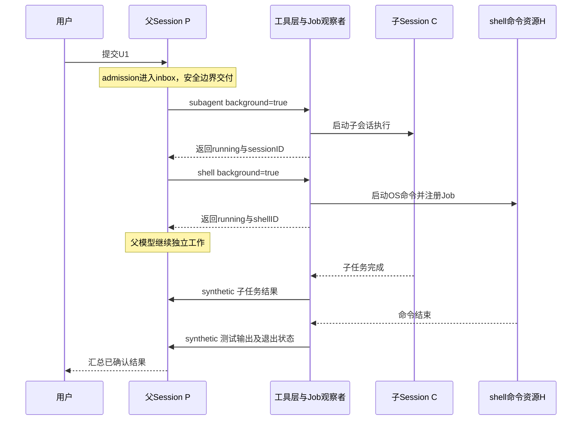

# 07 · 把实现放进时间线：六次完整推演

前面的章节按模块解释“怎样实现”，这里从用户动作出发，追踪一次工作究竟跨过哪些边界。所有任务、输出和短 ID 都是教学推演，不是本轮真实模型运行日志。P/C 表示父/子会话别名，U/A/T/J 表示输入、assistant、工具调用、Job；它们不是可直接提交 API 的真实 ID。模型选择的工具顺序也只是假定示例，系统不会硬编码每个任务必须按本章路线完成。

共同任务：“读登录代码，让 explore 找到真正入口，运行相关测试，最后告诉我结果。”假设项目文件是 `src/auth/login.ts` 和 `test/auth.test.ts`，权限允许这些操作，模型与凭据已经正常配置。

## 场景一：v1.2.24 怎样完成这四件事

我们假定模型依次选 read、task、bash，最后给出总结。先把业务步骤与模型请求次数分开：一个请求可以输出多个工具调用，也可能只输出文本；标题生成、压缩等内部模型调用又不等于用户任务的一步。这里取单工具逐步发生，是为了容易观察。

| 时间点 | 活动执行 | 保存/观察到的状态 | 下一步由谁决定 |
| --- | --- | --- | --- |
| t0 | 创建父 Session P | 会话元数据存在，但没有模型请求 | 调用方是否提交输入 |
| t1 | prompt 保存 U1 | user message 与 text part 已可查询 | noReply 判断、随后进入 loop |
| t2 | loop 获得 P 的 owner | 内存有 AbortController；status busy | loop 从持久历史准备模型输入 |
| t3 | 创建 A1，调用 LLM.stream | assistant 与 usage/finish 的容器建立 | 模型输出 read 调用 T1 |
| t4 | SDK execute(read) | T1 的 part 从 pending/running 走向 completed | SDK 回传结果，processor 保存状态 |
| t5 | 外层 loop 重读历史 | 模型历史包含 read 的结果 | 下一次模型请求选择 task T2 |
| t6 | task 创建 child C | C.parentID=P，独立用户输入 C-U1 | child 自己的 SessionPrompt.loop |
| t7 | 子模型搜索入口并完成 | C 的消息/part 逐步保存 | TaskTool 取得最终文本 |
| t8 | 父 task T2 完成 | 父历史里出现 task_result 与 child ID | 父 loop 再次调用模型 |
| t9 | bash T3 启动测试进程 | OS 进程输出；工具 part 显示 running | 等进程结束/错误/取消/超时 |
| t10 | T3 保存测试结果 | completed 或 error，附输出/退出信息 | 模型看到结果后生成 A4 总结 |
| t11 | 正常 finish、无更新输入 | assistant 完结；最终 owner 清理，回到 idle | 调用方收到结果 |

这里发生了两个“父等待”：task execute 等 child 的循环结果，bash execute 等 OS 命令结果。它们等待的是不同类型对象。JS 事件循环不必停住；别的 Session、流式 UI 或网络连接仍可以处理自己的异步工作。

如果 t6 发现输入传了旧 task_id，就不是新建 C，而是继续旧子会话。新 child 也没有天然读到父历史；例如父模型只说“查入口”，却没把刚读到的文件路径或限定条件写进 task.prompt，child 可能重新搜索甚至走偏。这是交接信息不足，不是“子 agent 记忆坏了”。

调试此路线，最有用的三个断点是：`createUserMessage` 完成后看 U1、SDK execute 回调开始时看 T1 的上下文、父 task 返回前看 child Session 与结果包装。你不必先理解所有 provider 参数，就能确认主闭环是否连接正确。

## 场景二：最终 V1 的后台 task 到底让谁先走

现在把 explore 设置为后台任务，仍使用最终 V1 的 `task` 与实验开关。与场景一相比，父工具调用不再等 child 最终文本，而是先返回“正在运行”的状态。

```text
父 P 的模型调用 task T2
  ├─ 创建或复用 child C
  ├─ BackgroundJob.start(J=C)
  ├─ 注册完成观察
  └─ T2 先返回 running

父 P 后续可以继续模型步骤                 child C 继续自己的 loop
              │                                    │
              │                           最终结果/失败进入 Job
              │                                    │
              └──── synthetic prompt ← 完成观察者 ──┘
```

这不是把 T2 从 running 状态永远挂在那里，而是 T2 的这次调用已经有一个即时结果。child 的最终结果通过一条后来的输入回到父会话。于是父模型可能先答“正在查找，接下来我先读测试配置”，随后才看到 explore 结果；这两段输出在时间上分开是协议预期。

如果完成观察者回注时父 P 正忙，输入进入父会话路径并由其运行控制协调。它不应该绕过 RunState，强行同时开第二个父 loop。理解这一点能回答“后台任务完成为什么还要给父会话发送新 prompt”：因为模型需要在后续请求中消费新事实，不能修改一个已经发出去的请求。

这个版本还有前台转后台：原先 T2 正在等 job.wait，promotion 信号先到，前台等待解除，T2 改为返回 running，child 没有因此重启。若你在日志里看到同一个子会话 ID，不能误判为重复任务；它可能是同一工作换了等待策略。

边界也明确：BackgroundJob 的活跃 registry 是内存，作用域释放或进程死亡不会把同一个 Fiber 保留到下次启动。B 有后台能力，但还不是 N 的整套持久通知与恢复策略。

## 场景三：当前 V2 同时有后台 child 和后台测试命令

N 的两个工具名分别是 `subagent` 与 `shell`。为了让父模型还可以做不依赖结果的工作，假定这两项任务互不写同一文件，且模型选择后台模式。工作分派仍受权限与模型输出控制，系统不会自动证明它们绝不冲突。



下面是这次工作的“身份账本”：

| 身份 | 表示什么 | 后续用它做什么 |
| --- | --- | --- |
| P | 用户任务的父 Session | 查询主历史、inbox、活动执行 |
| U1 | 最初用户输入身份 | 重试 admission 时幂等核对 |
| T-explore | 父模型本次工具调用 | 记录即时 running 结果；与最终子消息不是同一身份 |
| C | 子 Session | 续接同一个 child；其 Job 也与 child 关联 |
| T-test | 父模型另一次工具调用 | 记录后台 shell 启动结果 |
| H | shellID | 查询状态、输出、终止/移除命令资源 |
| J-test | shell 对应 Job | 控制前后台等待、结果与通知 |
| N-child / N-shell | 完成通知身份 | 防止丢确认后重复 admission 同一完成输入 |
| PID | 具体命令的 OS 进程号 | 操作系统进程管理；不用于代替 SessionID |

后台开始以后，父工具拿到的是 running 身份和观察信息，不是未经运行就宣告“测试通过”。最终总结应依赖终态通知中的真实退出信息；输出文件刚建立或 PID 尚存在，都不是测试通过的证据。

完成结果到达父会话，也有几个分离的时刻：工作终结、Job 保存终态、观察者构造 synthetic、synthetic admission 成功、runner 交付、模型后续 step 读到。通知被接收后确认 marker，不等于模型已经理解了它。这个区别在父会话被关闭、休眠或发生错误时尤其重要。

## 场景四：执行中来了 steer 和 queue

假设 P 正在一个模型 step 中，模型刚输出一个工具调用。用户先提交 U2：“只看登录模块”，又排队 U3：“做完后再解释缓存模块”。U2 是 steer，U3 是 queue。

1. 两项输入先分别 admission；当前模型请求的消息数组不会被原地改写。
2. 当前 step 已启动的前台工具完成并结算后，runner 到达安全边界。
3. U2 有机会交付，成为后续模型步骤的可见输入。用户输入的步数计数按规则重置。
4. U3 仍留 pending；当前工作如果还需要工具续步，不能为了队列而立刻混进下一段任务。
5. 当前工作将转空闲时，runner 交付一项 queue，再重新判断是否继续。

若用户想把 U3 的投递方式改成 steer，可以用 inbox update 改 delivery，并触发相应唤醒。 **这个 API 不等于编辑正文。** N 的该 PATCH payload 是 delivery；若要把“解释缓存”换成“解释数据库”，应先取消尚未交付的旧项、再用新 ID 提交新文本。交付与取消可能竞争，必须读取接口结果，不能假设点击编辑后模型从未见过旧项。

同 ID 的 user/synthetic 输入采用 first admission wins。网络重试是重试，编辑是新意图，不应复用一个幂等键同时表达两者。已经交付的消息也不因取消当前执行而从历史中自动消失。

## 场景五：停止按钮已返回，测试进程为什么还可能在清理

当前 N 的 interrupt 首先回答“是否接受了对本进程活动执行的中断请求”。它不要求 HTTP 请求等所有 finalizer 才返回；需要等待本 Session 前台 execution 清理和结算，用 awaitIdle/wait；它不自动等待全部后台 Job 或子会话。你要在界面上区分至少三种状态：停止已请求、正在清理、已空闲。

```text
用户点击停止
  → coordinator 标 stopping、认领已登记的wake、发出Fiber interrupt
  → HTTP 得到 { interrupted: true/false } 结果
  → 活动执行响应中断
  → 前台工具清理资源，命令层落实终止/强杀策略
  → settled hook保存对应终态、释放或保留claim
  → done结算，awaitIdle可以结束
```

“界面又显示了几行输出”可能来自已缓冲的流片段或清理期间的最终信息，不必立刻推断中断完全失败。反过来，“HTTP 返回成功”也不能证明所有外部资源已经停止。判断要看实际进程/工具/执行三层终态。

前台 child 等待中的 interruption 有显式传播；已经后台化的工作则有自己的 Job/会话生命周期。不能直接套用最终 V1 的递归后台取消规则。关闭某个 TUI 窗口更不是取消所有活动会话的同义词；当前客户端与服务分离，服务可能仍为别的界面或调用者工作。

## 场景六：最难的一刻——外部副作用发生了，本地结果还没保存就崩溃

设测试命令不只打印结果，还写了一个报告文件；或者工具已经向外部 API 提交变更。进程在“外部操作完成”与“本地结果写入投影”之间死亡。重启时能观察到的状态可能只是 running 工具、未释放 claim、待通知 job，而真实世界已经改变。

| 重启时看见的对象 | 可以做的推断 | 不可以做的推断 |
| --- | --- | --- |
| 未释放 execution claim | 上次忙碌期没有完成相应终结记录，应走恢复决策 | 上次模型请求从未发送 |
| streaming/running 工具投影 | 本地缺终态，需要收敛与显式报告 | 外部工具肯定没执行 |
| running shell recovery marker | 需要报告服务重启中断结果，不能接回原 PID 当作活着 | 重跑命令绝对安全 |
| 已完成但未确认通知 | 可以补 admission 同一通知并确认交付 | 必须重新执行整个任务才能得到通知 |
| 后台 child 的会话和恢复信息 | 可在身份/预算/旧owner状态允许时继续 child | 旧 Fiber 本身被序列化保存了 |

N 的启动恢复提供了比旧内存映射更多的决策依据，但不是消灭模糊结果。恢复预算防止坏会话无限重启；at-least-once 连续性则要求调用方理解重复执行风险。副作用工具如果要接近业务上的 exactly-once，需要自己的幂等键、事务或对账协议。

PTY 又是另一条分支：普通 scope PTY 与 PersistentPty daemon 不同。受控服务替换可做 prepare_handoff/accept；突然断电、整机重启、daemon 自己死亡不能因此保证同样存活。不要把交接机制扩写成“所有终端永不丢失”。

## 用什么证据验证你的理解

阅读一条链时，按这个顺序记观察点：

1. **身份：** 这是谁的 Session、输入、assistant、tool call、Job、shellID？不要把关联键混成一个 task ID。
2. **可见性：** 输入只在 inbox，还是已进模型历史？工具只有启动收据，还是已有最终结果？
3. **所有权：** 哪个 scope/Fiber/进程负责推进？哪个等待者断开不会杀 owner？
4. **提交：** 哪一项在数据库事务里，哪一项只是实时通知，哪些信息受原始日志保留配置影响？
5. **失败：** 这里失败由谁结算，能重试哪一步，是否可能已经产生外部副作用？

不要在未配置新版本依赖的环境里，把“某条命令退出 0”或“进程还在”当成这些机制全部验证通过。本书以固定提交源码为证据；可以把它当作下断点和设计实验的路线图，实际功能结果仍需在对应版本、正确模型和服务条件下验证。
